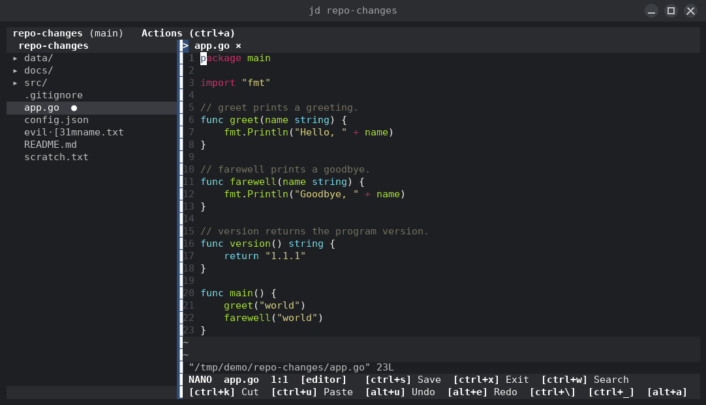
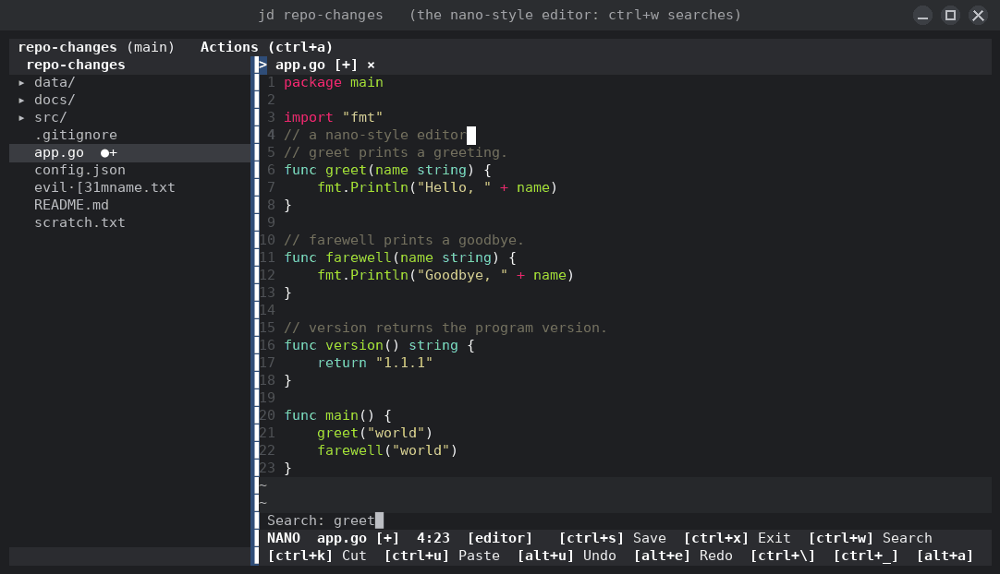
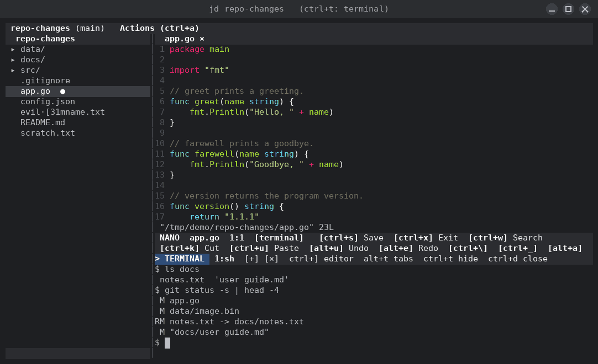
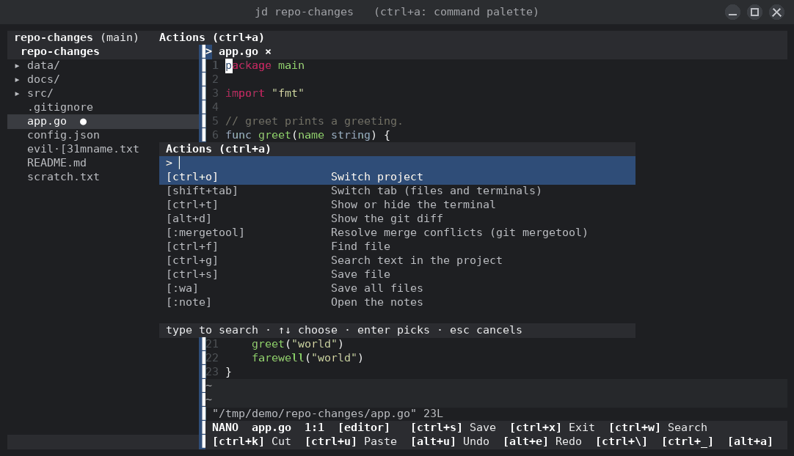
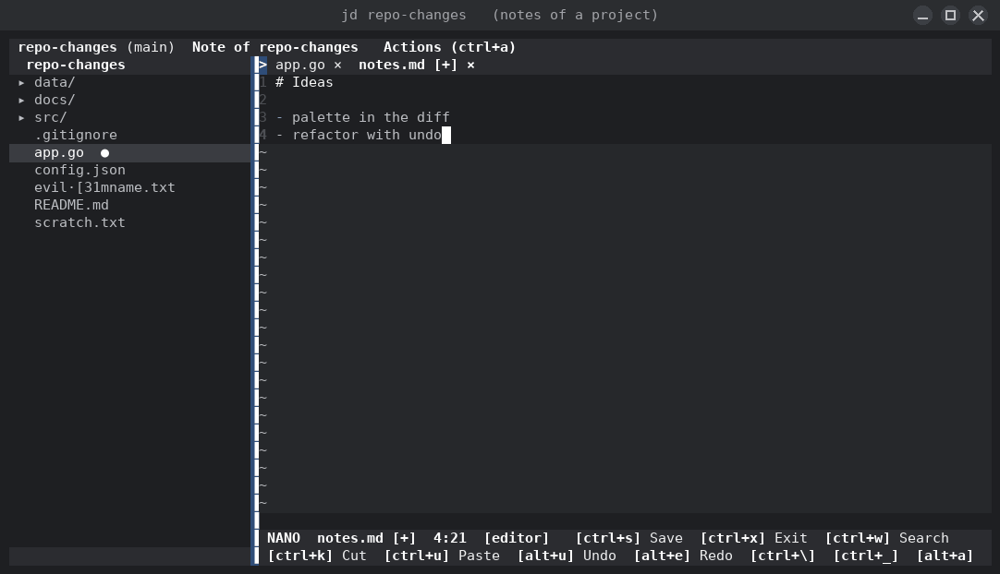
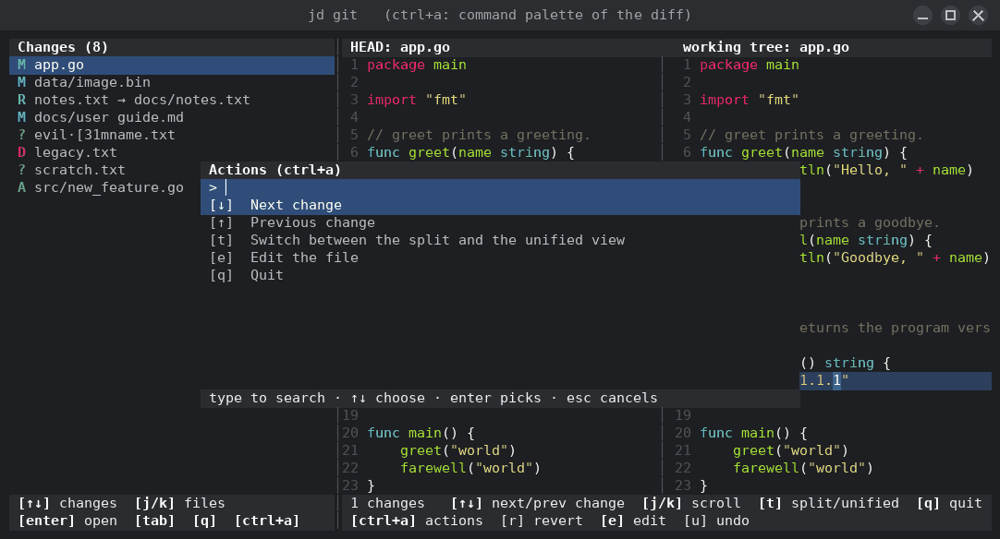
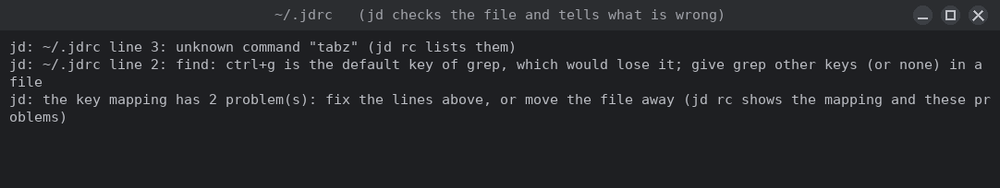
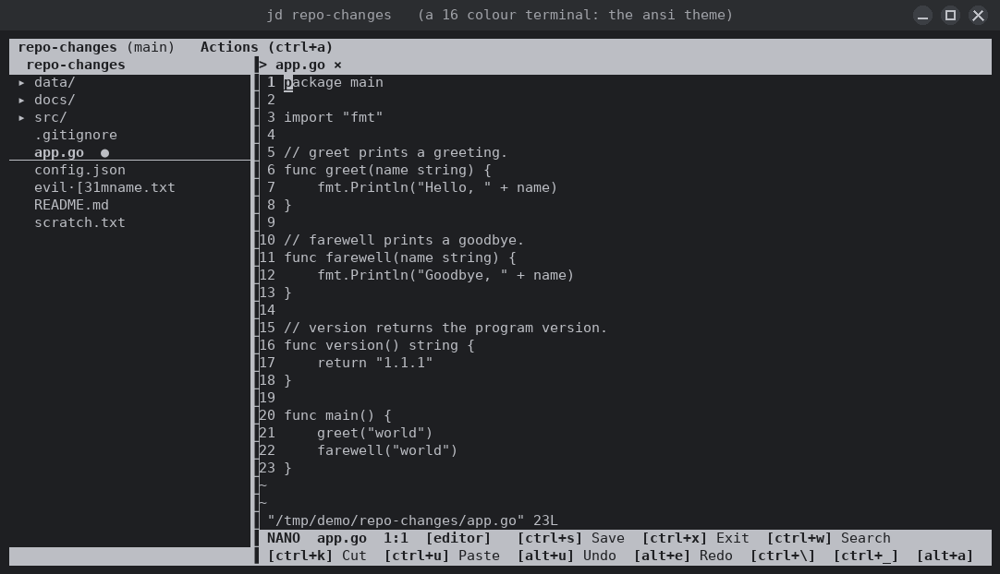
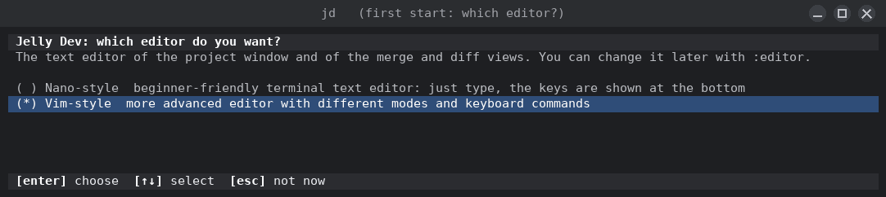
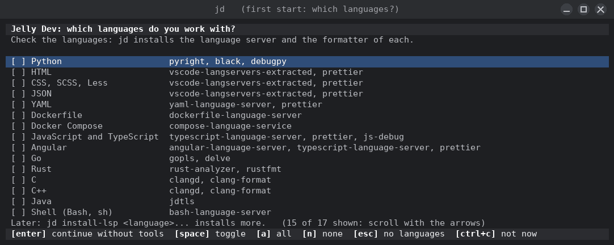

# Jelly-Dev

<p align="center"></p>

<p align="center">
  <a href="https://github.com/Eutima/jelly-dev/actions/workflows/ci.yml"></a>
  <a href="https://github.com/Eutima/jelly-dev/actions/workflows/ci.yml"></a>
  <a href="https://github.com/Eutima/jelly-dev/actions/workflows/ci.yml"></a>
  <a href="https://github.com/Eutima/jelly-dev/actions/workflows/ci.yml"></a>
  <a href="https://github.com/Eutima/jelly-dev/actions/workflows/ci.yml"></a>
  <a href="https://github.com/Eutima/jelly-dev/actions/workflows/ci.yml"></a>
  <a href="https://github.com/Eutima/jelly-dev/actions/workflows/ci.yml"></a>
  <a href="https://github.com/Eutima/jelly-dev/actions/workflows/release.yml"></a>
</p>

**An intuitive, easy to use terminal IDE with a clear diff and merge UI.** A project tree, an editor with language servers (nano-style or vim-style, your choice), a shell
panel and a command palette, plus side-by-side diffs, a three-pane `git mergetool` and conflict resolution with Claude or Codex.
One static binary, one command: `jd`.

Linux · macOS · Windows · Docker · `pip install jelly-dev`

[Install](#install) · [Screenshots](#screenshots) · [The IDE](#the-ide) · [Diff, git and directories](#diff-git-and-directories) · [Merge](#merge) · [Shortcuts and .jdrc](#shortcuts-and-jdrc) · [Command line](#command-line) · [Installer and tools](#installer-and-tools)

## Install

The installers fetch the latest release and check it against the SHA-256 checksum published with it (an integrity check, not a
signature). They put `jd` on your PATH, install the tools the IDE needs and make `jd` git's diff and merge tool.

**Linux**

```
curl -fsSL https://raw.githubusercontent.com/Eutima/jelly-dev/master/scripts/install.sh | sh
```

**macOS** (missing tools are installed with Homebrew when it is installed; the installer does not install Homebrew itself)

```
curl -fsSL https://raw.githubusercontent.com/Eutima/jelly-dev/master/scripts/install.sh | sh
```

**Windows** (PowerShell)

```
irm https://raw.githubusercontent.com/Eutima/jelly-dev/master/scripts/install.ps1 | iex
```

If Windows says *Access denied* (*Zugriff verweigert*) when `jd.exe` starts, security software or a policy is blocking the new, unsigned program; the download itself
is checked against the published SHA-256 sum. A notice *Verringerung der Angriffsfläche* / *Attack surface reduction* (rule *Use advanced protection against
ransomware*) means Microsoft Defender does not know the file yet: exempt it (PowerShell as administrator:
`Add-MpPreference -AttackSurfaceReductionOnlyExclusions "$env:LOCALAPPDATA\Programs\jelly-dev\jd.exe"`; on a managed PC your administrator adds the exclusion).
Otherwise look in *Windows Security > Virus & threat protection > Protection history* for a blocked or quarantined `jd.exe`, or ask your administrator
(AppLocker, Windows Defender Application Control). The installer tests `jd.exe` right after copying it and says so.

**pip** (Linux glibc/musl including Alpine, macOS 11 or newer, Windows; x86-64 and arm64)

```
pip install jelly-dev      # puts the jd command on the PATH; pipx install jelly-dev works too
```

Without root rights (a normal user in a container, a system Python) pip installs *to the user*: `jd` is then in `~/.local/bin`, which many shells do not have
on the PATH, and `jd` says *not found*. Run `export PATH="$HOME/.local/bin:$PATH"`, or start
it once with `python3 -m jelly_dev`: its first start adds the folder to your shell profile, so new shells find `jd`. As root (a Dockerfile `RUN`) `jd` goes to `/usr/local/bin`.

**Docker**: the pip install is also the quickest way to get a nice editor inside a container: `RUN pip install jelly-dev` in a Dockerfile (Alpine, Debian
or Ubuntu image with Python; with a non-root `USER` add `ENV PATH="$HOME/.local/bin:$PATH"` after the `USER` line, or the full path of that user's home folder), then `docker exec -it <container> jd`. The wheel carries the static binary, jd needs no root, no `HOME` and no
write access to the root file system (CI runs it that way), and it has a project tree, an editor, diffs and a shell panel, so a
quick fix or a look at the files of a running container needs no other tools. Node.js and npm, which some language servers need, do not have to be in the
image: jd installs them below `~/.local` when the first such server is added (`:addlang`, `jd install-lsp javascript`, or when a window opens), so
`RUN pip install jelly-dev && jd install-lsp javascript` prepares them at build time.

Then reload the shell (`exec "$SHELL" -l`, or open a new terminal) and check it: `jd --version`. Start the IDE with `jd` or
`jd <folder>`. What the installer does, the tools and the options are under [Installer and tools](#installer-and-tools).

## Screenshots

Taken from the [playground](playground/README.md) examples (`python3 playground/screenshots.py` makes them again).


*The project window: file tree, file tabs and an editor (nano-style or vim-style) with syntax colours; `ctrl+o` projects, `ctrl+t` terminal, `shift+tab` tabs, `ctrl+f` and `ctrl+g` search.*


*The nano-style editor, the beginner-friendly one: no modes, the keys at the bottom (`ctrl+w` opened the search prompt); the vim-style editor is a choice away.*


*A shell in a panel under the editor (several tabs), like in VS Code.*


*Search in the files of the project (`ctrl+g`), file names with `ctrl+f`.*


*The command palette (`ctrl+a` or `f1`, also in the diff and merge views): every action with its shortcut, type to narrow the list.*


*Notes (`:note [name]`): a Markdown file in an editor tab, kept per project in `.jd/notes/`; the top bar says which project the note belongs to (`:note project` chooses it).*


*The diff views have a palette as well: next and previous change, split or unified, revert, edit and undo.*


*Every shortcut can be changed in `~/.jdrc` (or `.jdrc` in a project; `jd rc` prints the defaults): jd checks the file and tells what is wrong before it starts.*


*Three-way merge (`jd merge`, also git's merge tool): ours, result and theirs, per conflict `→` ours, `←` theirs, `b` both, `e` edit.*


*Compare two files: side by side, with syntax colours and word-level highlights (`t` switches to the unified view, `↓`/`↑` jump between the changes).*


*`jd git`: the changes of a git repository, a file list next to the diff of the selected file.*


*Compare two directories (`jd <dir-a> <dir-b>`): every added, removed and changed file.*


*A terminal with 16 colours: jd chooses the `ansi` theme by itself, drawn in reverse video so that it is readable in any palette.*


*`:addlang` lists all languages: pick one and its language server and formatter are installed.*


*The first start asks which editor you want: nano-style (beginner-friendly) or vim-style (more advanced: modes and keyboard commands); `:editor` changes it later.*


*The first start asks which editor you want (nano-style or vim-style) and which languages to install language servers and formatters for.*

## The IDE

`jd` with no argument opens the **most recent project** (a folder) in the project window: the file tree on the left and a
editor on the right; with no history it shows a welcome screen with the recent projects (`enter` opens it in this window, without a question,
`w` open in a new window, `o` type a folder, `d` forget, `q` quit). `jd <folder>` opens that folder, `jd <file>` opens the
file in its project (the git root, else its folder); a name that does not exist yet starts a new file. The list of recent
projects, and for each one the file and cursor that were open, is kept in `<user config dir>/jd/projects.json`
(`JD_CONFIG_DIR` changes the folder), so the next `jd` continues where you stopped.

**Actions** (the command palette): `ctrl+a` (or `f1`, or a click on *Actions* in the top bar; the same key closes it again) opens a searchable list of
all actions with their shortcuts: switch project, terminal, git diff, find file, search text, save, format, `gd`/`gr`, tabs, focus, theme,
tools, quit. Type to narrow it, `enter` or a click runs the entry, `esc` closes it. The bars show nothing else: the top bar has the project,
the branch and *Actions*, and the footers only the mode and position and `[ctrl+a] actions`. (`ctrl+shift+p` cannot be used: a terminal
sends it as `ctrl+p`, and Windows Terminal keeps it for its own palette.)

The diff views (`jd git`, the *Diff* of the window and `jd diff`) have the same palette on `ctrl+a` or `f1` (the `diff.palette` command in `.jdrc`): next and
previous change, split or unified, and, where the file can be changed, revert, edit and undo.

**Diff against branches, revisions and worktrees** (from the palette or with `:` commands; the diff view is `jd git`, `q` returns):
`:diff <revision>` or `:diff <a>..<b>` (also `:diff --staged`) takes any revision git knows (`main`, `v1.2`, `HEAD~3`, `origin/dev`, a commit hash);
`:diffrev` lists the branches, remote branches, tags and the latest commits to choose from; `:diffrevs` chooses the two sides one after the
other; `:difffile` compares only the file of the shown tab with a revision; `:diffworktree [dir]` compares the project with another working tree of
the repository (a list of `git worktree list`, or any folder) as a directory diff, the other tree being the old side. A revision that does not
exist is a message, not an empty screen. As in `jd git`, the new side is the working tree, so changes can be reverted and edited there.

**Which pane has the focus** (tree, editor or terminal): the title of that pane starts with `>` (the project name above the tree, the tab bar, `TERMINAL`),
the footer of the editor names it (`[tree]`, `[editor]`, `[terminal]`), the divider between tree and editor is a half block pointing at it (`▌` tree,
`▐` editor), the text of the other panes is drawn faint and the editor shows its cursor only when it has the focus. None of it depends on colours, so it
also works in terminals with 16 colours or none. `ctrl+e` switches between tree and editor, `ctrl+t` shows the terminal.

**Merge conflicts**: when the project is in a merge with unresolved conflicts, the top bar shows `! N conflicts (:mergetool)`. A click, `:mergetool`
or the palette entry runs `git mergetool` with jd as the tool (whatever git is configured with): one merge view per conflicting file, the result
is staged when you save. The window looks again after the merge tool ends and now and then while you type.

**Top bar and shortcuts**: *Diff* shows the git changes of the project as in `jd git` (`alt+d`, `D` in the tree or `:diff`; `q` returns to
the editor; save first, the diff shows what is on disk). `ctrl+o` works in the tree and in the editor's normal mode (`ctrl+t` and `alt+d` everywhere) (`ctrl+b` is the way
back after `gd`/`gr`). *Terminal* opens a shell in the project in a panel under the editor, like VS Code. Everything you type goes
to the shell; `ctrl+]` (or a click on the editor) gives the focus back, `ctrl+t` (also from the editor and the tree, where it shows the panel) or the
palette entry hides the panel (the shells keep running). The panel has **tabs**, one shell each: `[+]` (or `:terminal new`, or *New terminal* in the
tab list) opens another, a click or `alt+1` … `alt+9`
chooses one, `ctrl+d` or `[×]` ends the shown one; a shell that exits closes its tab, the last one takes the panel with it. On Windows the panel runs `$SHELL`, else PowerShell 7 (`pwsh`), else Windows PowerShell, else `%ComSpec%` (cmd.exe), in a ConPTY (Windows 10 version 1809 or newer), so the shell is inside the window
like on Linux and macOS; on an older Windows it runs in place of the window until you `exit`.

**File tabs**: every file you open from the tree, a search or `gd`/`gr` gets a tab above the editor (an open file is shown, not
opened twice); each tab keeps its own text, undo history and cursor. `gt` / `gT` (or `:tabn` / `:tabp`, `:bn` / `:bp`) show the next /
previous tab, a click on a name shows it, a click on `×` (or `:bd`, `:tabclose`) closes it; `:closeother` (`:tabonly`) closes all tabs but the shown one, `:closeall` (`:bda`) closes every tab and moves to the tree (tabs with changes ask first). `:q`, `:wq` and `ctrl+d` close the tab, the
last one leaves (`ctrl+d` closes a saved tab at once and asks only when it has unsaved changes); `:wa` writes all files, `:qa` leaves when nothing is unsaved and `:qa!` anyway. The open tabs come back with the project.
The footers and bars adapt to the width: on a narrow terminal the last commands lose their label (the `[key]` stays clickable) and then
drop out, the first ones stay.

**Tab list**: `shift+tab` (in the tree and in the editor's normal mode, not in insert mode or the terminal panel, where the editor and the shell keep it) or `alt+t` (everywhere,
also inside the terminal panel; also `:tabs`, `:buffers`, `:ls`, or the palette) opens a searchable list of all tabs: the open files (`[+]` marks unsaved changes), the
running shells and *New terminal*. Type to narrow it, `↑`/`↓` choose, `enter` or a click shows the tab (a file in the editor, a shell in the panel), `esc` or the key that
opened it closes it. `ctrl+t` shows or hides the terminal panel.

**Narrow terminals**: in every view (project window, diff, git, merge, welcome and search) the footer wraps onto a second line when
the commands do not fit (labels shrink to the `[key]` and then the last commands drop out only when two lines are not enough), and
long messages (a file path, an error) wrap at the spaces over up to three lines (two in the other views) instead of ending in "…". The
merge view has one footer line and a compact one below 10 lines.

**Unsaved changes**: closing a tab or switching project asks *Save / Discard / Cancel* (`s`, `d`, `c`,
`←/→` and `enter`, or a click).

**Switching projects**: `ctrl+o` (or `P` in the tree), `:project` (without a folder) or `:projects` / `:recent` open the list of
recent projects; `enter` opens the chosen one and asks *new window?* (`y`: a new window, `n`: this window, `esc`: back), `o` lets you type a folder (with `tab`
completion; the same question follows, and a folder that does not exist is offered for creation first), `d`
forgets an entry, `esc` closes the list. `:project <folder>` switches this window directly (the folder may be relative to the project or start
with `~`); `:project!` discards unsaved changes, otherwise they block the switch (E37). The file and cursor that were open are
stored first and come back when you return to a project; the language servers follow the window to the new project.

**New windows**: `w` in the tree on a folder, `:window [folder]` in the editor and `w` on the welcome screen
start a new terminal window running `jd` on that folder. jd uses tmux (`tmux new-window`) when it runs inside tmux, Windows
Terminal when it runs in **WSL** or Windows, Terminal.app on macOS, and on Linux the first terminal it finds
(x-terminal-emulator, gnome-terminal, konsole, xfce4-terminal, kitty, wezterm, alacritty, foot, xterm). Set `JD_TERMINAL`
(for example `JD_TERMINAL="kitty"`) to choose another one; jd and the folder are appended to it. The value is split at spaces (no quoting), so a path with spaces needs a wrapper script. Where no terminal can be started (a container, an ssh session) a project
opens in the current window instead.

Closing: `ctrl+d` from the tree and from the last editor tab always asks first, even when nothing changed: a box
asks *Quit Jelly-Dev?*, `y` or `enter` closes, `n` or `esc` stays, and pressing
`ctrl+d` again also closes. With several tabs `ctrl+d` closes the shown tab at once when it has no unsaved changes. A file with unsaved changes asks *Save / Discard / Cancel* instead, for every changed tab when quitting.
After a jump (`gd`, `gr`) `ctrl+c` and `ctrl+d` still go back first. `ctrl+c` and `esc` never close anything (`ctrl+c` only returns to
normal mode, like `esc`); only `ctrl+d`, `:wq`, `:q` and `q` in the tree close. In the terminal panel `ctrl+c` belongs to the shell and `ctrl+d` ends the shown terminal tab (a shell that has nothing to read ends by itself on `ctrl+d` as well). `:q`, `:wq` and `q` in the tree are explicit and close without the box.

Welcome screen "open folder" (`o`): type a path and press `tab` to complete it (a single match completes the whole folder, several
matches complete their common part, further presses walk through them; `shift+tab` goes back). The matching folders are listed
while you type and can be chosen with the arrows; `enter` opens the folder (on the welcome screen in this window right away; inside a project window it asks whether that is a new window (`y`) or this one (`n`)),
`ctrl+w` opens it in a new window right away. A path that does not exist asks *Create this folder?* (`y` makes it, with its parents, `n` goes
back to the prompt).

Tree keys: `j`/`k` move, `enter`/`o` open a file or toggle a folder, `h`/`l` collapse/expand, `R` refresh, `w` new window,
`n` new file, `d` delete, `e` edit (open) the file; the footer under the tree shows only these three. `n` asks for the name and
creates it in the selected folder, or next to the selected file; `tab` in the prompt switches between that folder and the
project folder (the way to the root when the tree has only folders), a name ending in `/` makes a folder, and the new entry
cannot leave the project. `d` asks first, and the question starts on *No*. `ctrl+e` or `tab` switch to the editor, `q` quit (`ctrl+e` switches back to the tree). Entries of `.git` and the root
`.gitignore` (names and globs) are hidden. The mouse works in the tree, the editor and the footers.

**Two editors, you choose** (the editor of the project window and the one of the merge and diff views): the **nano-style** editor has no modes - you type, the
keys are shown at the bottom - and the **vim-style** editor is modal. The first start asks which one you want (vim is preselected; `jd setup` asks again), `:editor nano` /
`:editor vim` or the entries *Editor: nano style* / *Editor: vim style* in the actions (`ctrl+a`) change it at any time for every open file, `JD_EDITOR=nano|vim` decides for one
run. Someone who finished the first-start setup before this choice existed keeps vim until they choose; an install without a terminal (a Docker build) gets nano. The choice is
kept in `editor.json` in the config folder.

**The nano-style editor**: type to insert, the arrows, `home`, `end`, `pgup`, `pgdown`, `delete` and `backspace` do what you expect, `ctrl+s` saves. Keys (the bottom line shows them, a click
on a hint presses it; all of them can be changed with `nano.*` in `.jdrc`):

| Key | Action |
|---|---|
| `ctrl+s` | save |
| `ctrl+x` | leave the file (asks *Save modified buffer?* when there are changes: `y` saves, `n` discards, `esc` stays) |
| `ctrl+k` / `ctrl+u` | cut the line (or the marked text) / paste; consecutive cuts add up |
| `alt+a` (`ctrl+^`), `alt+6` | set the mark and select to the cursor / copy the marked text |
| `ctrl+w`, `alt+w` | search for text (plain text, case does not matter) / the next match |
| `ctrl+\` (`alt+r`) | search and replace: asks for the text and the replacement, then `y` replaces, `n` skips, `a` replaces all, `esc` stops |
| `ctrl+_` (`alt+g`) | go to a line (`12` or `12,5`) |
| `alt+u` / `alt+e` | undo / redo (typing in one go is one step) |
| `ctrl+left`, `ctrl+right`, `ctrl+home`, `ctrl+end`, `ctrl+y`, `ctrl+v` | a word left/right, start/end of the file, page up/down |

The keys of the project window go first: `ctrl+a` (actions), `ctrl+e` (focus), `ctrl+f` / `ctrl+g` (search in the project), `ctrl+o` (projects), `ctrl+b` (back after a jump), `ctrl+d` (close the
tab, asks when there are changes), `ctrl+t` (terminal) - nano's own meaning of those is on `home`, `end`, `delete` and the actions. `ctrl+space` completes (language server), `:`-commands are in
the actions. `ctrl+\`, `ctrl+_` and `ctrl+^` are not sent by every terminal: their `alt+` alternatives always work.

Vim-style editor: normal, insert and visual mode with the keys listed under "Merge" (the same engine; all of them are the defaults of the `vim.*` and `insert.*` commands, see "Shortcuts and .jdrc"), line numbers, syntax highlighting,
scrolling, `:w [file]`, `:wq`, `:x`, `:q`, `:q!`, `:e[!] file`, `:set nu|nonu`, `:{n}`. Files are written atomically with
their line endings. Not yet: splits, diagnostics and the rest of vim.

**Search in the open file** like vim: `/pattern` forwards, `?pattern` backwards (a regular expression; a pattern that is none is searched
literally; start it with `\c` to ignore case), `enter` jumps, `n` / `N` repeat in the same / the opposite direction and wrap around the
end of the file, an empty `/` repeats the last pattern, and `:noh` removes the highlight of the matches.

**Search** (`ctrl+f` file names, `ctrl+g` file content; in the tree also `/`; `:find [name]`, `:grep [text]`): a full-screen search over
the project. `tab` switches between the two. File names are matched fuzzily (`uied` finds `internal/ui/editor.go`; several words must all
match; names rank above paths). Content search starts while you type (smart case: lower case ignores case, a capital letter makes it
case sensitive; `alt+c` makes every query case sensitive; `ctrl+r` switches to regular expressions) and lists `file:line  text` with the match highlighted. `enter` or a click
opens the file at the match, `esc` (or `ctrl+d`) closes. `node_modules`, `.venv`, `venv`, `__pycache__`, `.tox`, `.gradle`, `.idea`,
`.git`, caches and everything in the project's `.gitignore` or an optional `.jdignore` (same patterns) are skipped, as are binary
files and files over 1 MiB.

**Notes**: `:note [name]` (or *Open the notes* in the palette) opens a note, by default `notes`, as a Markdown file in an editor tab; `:w` saves it
as `<project>/.jd/notes/<name>.md`. The notes belong to the project you chose with `:note project` (the project list opens, only to choose: it never asks about a new window; the choice is stored
in the config folder), whichever project the window shows, so one place keeps your notes while you work in another project. Without a choice they
belong to the open project. The top bar says *Note of <project>* while a note is shown. Add `.jd/` to the `.gitignore` of a project whose notes are private.

**Copy the file path**: `:copypath` puts the path of the shown file, relative to the project, on the clipboard; `:copypath abs` the absolute path
(both are in the palette).

**Refactoring** (needs a language server that renames; `:format` and `gd` use the same ones): `:refactor <new name>` renames the symbol under the
cursor (method, variable, type...) in every file of the project, `:refactor file <new name>` renames the file of the shown tab (the extension stays
when you leave it out; the server also updates the imports where it can). jd asks first and lists how many edits and files are involved; save your
changes before (the files are changed on disk). `:refactor undo` reverts the latest refactoring, also after jd was restarted: the old texts are kept in
`<project>/.jd/refactor-journal.json` (the last 20; it holds whole files, so keep `.jd/` in your `.gitignore`). An undo is refused when one of the files was changed after the refactoring, so later work is
never overwritten. Edits outside the project folder are never applied.

**Select text in the terminal**: press and drag in the terminal panel to select text; letting go copies it to the clipboard.

**Language servers** (started when first needed, per project): `gd` jumps to the definition of the symbol under the cursor, `gr` lists
its references (`j`/`k`, `enter` or a click jump), `ctrl+b` returns to where the last jump started (also after a search jump), also
across files; so do `ctrl+c` and `ctrl+d` in normal mode, one step at a time, and only when there is no jump left to undo `ctrl+d` closes the
window (`ctrl+c` does nothing) (unsaved changes block going back to another file, E37). `:format` (`:fmt`) formats the file as one undoable change: with the file type's formatter command when installed (Go: `gofmt`;
HTML, CSS, SCSS, JavaScript, TypeScript, JSON: `prettier`; Python: `black`), otherwise with the language server (Java is formatted
by jdtls). When no formatter is found for the file (no server for the file type, a server that cannot format, a missing server), a
searchable list of formatters opens (gofmt, goimports, prettier, black, ruff, shfmt, clang-format, rustfmt, jq, xmllint, yamlfmt, taplo ...;
the ones for the file type come first, missing ones are dim): type to narrow it, `enter` formats with the chosen one and remembers it
for that file type once its result was applied (`formatters.json` in the config folder; delete the entry there to forget it), `esc` cancels. `ctrl+space` (or `ctrl+n`) in insert mode opens the completion popup with the server's
suggestions and the words of the file as a fallback: typing narrows it, `ctrl+n`/`ctrl+p` or the arrows choose, `tab` or `enter`
accept, `esc` closes it. Defaults: gopls (Go), typescript-language-server (JavaScript, TypeScript, JSX), pyright (Python),
vscode-html/css/json-language-server, jdtls (Java); the installer sets them up. Add or change servers in
`<config dir>/jd/lsp.json`: `{"servers": [{"name": "rust", "command": ["rust-analyzer"], "extensions": [".rs"], "languageId": "rust",
"rootMarkers": ["Cargo.toml"], "formatter": ["rustfmt", "--emit", "stdout"]}]}` (an entry with the name of a default replaces it).

**Tools are installed for you**: when a project window opens, jd checks for the language servers and formatters (gopls,
typescript-language-server, pyright, the HTML/CSS/JSON servers, the Angular language server, jdtls,
prettier, black) and **installs what is missing in the background**, one after the other, with the language's own tool (`go
install`, `npm install -g --prefix ~/.local`, `pipx` or `pip --user`, or a download); the progress shows in the status line
and the result when it is done. A missing Node.js (with npm, which the npm servers need) is installed first by jd itself, with the pinned and checksummed download of the installer script
below your home folder, or with your package manager when you have root rights, so `pip install jelly-dev` and adding a language is all it takes, also without
a terminal (`JD_SKIP_DEPS=1` turns that off). The other runtimes (Go, Python, Java) are reported, not installed: jd never
asks for root rights; the installer (`jd setup`) installs them, below your home folder when you have no root rights. A tool
that failed is tried again after a day; `:tools` tries all missing
ones now and `:tools status` lists what is missing. `JD_NO_AUTO_INSTALL=1` turns the start-up installation off. Tools end up in
`~/.local/bin` (and Go's bin folder), which jd adds to its own PATH. Angular templates (`*.component.html`) use the Angular
language server (it finds `typescript` and `@angular/language-service` in the project's `node_modules` or the global ones).

**Clipboard**: copied and deleted text (`y`, `d`, `x`, ...) is also put on the system clipboard, and `p` pastes what is on it, so text
moves between the editor and other programs (WSL and Windows use PowerShell, macOS pbcopy/pbpaste, Linux wl-clipboard, xclip or
xsel). Text pasted by the terminal is inserted as text, never run as vim commands. `ctrl+d` leaves insert and visual mode like `ctrl+c`.

## Diff, git and directories

Usage: `jd <file-a> <file-b>`. Flags must come before file names.
Exit codes: 0 ok (also when there are no differences), 1 runtime error, 2 usage error.
Clipboard: `jd --clip <file>` (clipboard on the right) or `--clip-left`. Reads via PowerShell on
WSL/Windows, `pbpaste` on macOS, `wl-paste`/`xclip`/`xsel` on Linux.
Git: `jd git [--staged] [<rev> | <a>..<b>] [-- <path>...]` shows a changed-file list (working tree vs HEAD incl.
untracked files by default) next to the diff of the selected file. In the list: `j`/`k` select, `enter` focus the
diff, `tab` switch focus, `esc` back. Three-dot ranges are not supported; flags must precede the revision.
Directories: `jd <dir-a> <dir-b>` lists the files that differ (modified, only left, only right) with the same
list-plus-diff view; use it from git with `git difftool --dir-diff` (its temporary directories hold links to the working tree files, which
are followed). Compared are regular files and links to regular files; links to directories, dangling links, special
files and `.git` directories are skipped.
Keys (diff): `↓`/`↑` next/previous change, `j`/`k` scroll, `g`/`G` top/bottom, `t` split/unified, mouse wheel, `q` quit.
The mouse is captured for wheel scrolling; hold Shift while dragging to select text in most terminals.

Keys in the diff views (the defaults; see "Shortcuts and .jdrc"): `↓`/`↑` next/previous change (in `jd git` and directory diffs with the diff pane focused, past the last or first change of a file they open the next or previous file), `j`/`k` scroll, `g`/`G` top/bottom, `t` split/unified, `q` quit.
In `jd git` (and the *Diff* of the project window) the new side is the working tree, so changes can be undone and edited there, like
in the merge view. With the diff pane focused (not for `--staged`, two revisions, deleted files or conflicts):

| Key | Action |
|---|---|
| `r` / `backspace` | revert the selected change: its lines go back to the old text (select a change with `↓` first) |
| `e` / `enter` | open the vim-style editor on the file (the cursor is on the selected change); `:w` or `ctrl+s` saves and stays, `:wq` saves and leaves, `:q` leaves (refuses while unsaved), `:q!` discards |
| `u` | undo the last revert or edit of this file (history is kept until you select another file) |

Every step is written to the file at once. Nothing is written when the file changed on disk meanwhile (select it again to reload it), and
line ends (CRLF) and a missing final newline are kept.

## Merge

Keys in the merge view (conflicts; the defaults, see "Shortcuts and .jdrc"):

| Key | Action |
|---|---|
| `n` / `p` | next / previous change |
| `→` / `←` | add ours / theirs to the change and stay on it (like `»` / `«`); the other arrow adds the second side (= both); the same arrow again removes the side |
| `x` | ignore both sides of an open conflict: keep the lines the result pane shows now (the base; nothing in `jd merge a b`), mark it resolved and stay on it |
| `backspace` / `delete` | cancel the decision for the change (unresolved again) |
| `o` / `t` / `b` / `r` | take ours / theirs / both / base and jump to the next conflict |
| `ctrl+o` / `ctrl+t` | take ours / theirs for all open conflicts |
| `m` | auto-resolve conflicts that are none in fact (whitespace, different words) |
| `a` / `c` | let Claude / Codex resolve all open conflicts (if the CLI is installed) |
| `e` / `enter`, `i`, `d` | open the vim-style editor on the change under the cursor (`i`: on a new line below), delete the line |
| `w` | wrap long lines (default) or cut them with `…` |
| `u` | undo |
| `ctrl+s` (or `s`) | save (when every conflict is resolved) |
| `q` | quit |
| `ctrl+a` (or `f1`) | command palette: every action above in a searchable list |

The footer of the merge view is one line, `[→] ours  [←] theirs  [e] edit  [ctrl+a] actions`; everything else is in the palette.

Merge: `jd merge <base> <local> <remote> <merged>` shows ours | result | theirs. Non-conflicting changes are
merged automatically; conflicts start with the base lines. The result pane has a line cursor:

- `j`/`k`/arrows move the cursor (the change under it is selected), `n`/`p` jump to the next/previous change.
- Gutter buttons (mouse, three-pane layout only): `»` applies ours, `«` applies theirs; applying the second side of a
  change gives both. `×` discards that side (the other side stays, or the base when none is left).
  A click stays on the change instead of jumping to the next conflict, so you can apply both and edit by hand.
  A button disappears (and is no longer clickable) once its action is done, e.g. `»` after ours was applied.
- `ctrl+→` or `ctrl+o` / `ctrl+←` or `ctrl+t` take ours / theirs for every conflict that is still unresolved (decided conflicts and automatic
  merges stay; one `u` undoes it).
- `→` / `←` work like the gutter buttons: they add ours / theirs to the selected change and stay on it, so the other side can
  still be added (the second arrow gives both); the same arrow again removes that side (like `×`) and `backspace` or `delete`
  cancels the whole decision. Move on with `n`. `o` takes ours, `t` theirs, `b` both and `r` reverts to the base, each
  followed by a jump to the next unresolved conflict. `x` ignores both sides of an open conflict (keeps the lines shown
  in the result now) and stays on it; unlike `r` it only applies to open conflicts and does not jump.
- `m` (auto-resolve) resolves every conflict that is none in fact: a change of whitespace only, or both sides editing
  different words of the same lines. Real conflicts stay open; one `u` undoes the whole step.
- `a` asks Claude (`claude` CLI) and `c` asks Codex (`codex` CLI) to resolve every conflict that is still open; a
  key is only active when its CLI is installed and on the PATH. The answer is applied as hand-edited result lines
  (review it, one `u` undoes the whole answer). **The three versions of every open conflict are sent to the
  assistant's service**, so do not use it on files that must not leave your machine. The assistant runs in an empty
  temporary directory without tools (Claude) or in a read-only sandbox (Codex) and times out after 5 minutes; `q`
  cancels a running request. Needs a logged-in CLI.
- `e` or `enter` opens a vim-style editor on the **change under the cursor** (`i` opens it on a new empty line below the
  cursor, in insert mode); `d` deletes the line under the cursor. The editor takes the whole screen and starts in
  normal mode. The lines of the change are editable; all other lines of the result are shown above and below,
  dimmed and read-only: the cursor can walk over them (`j`/`k`, arrows, `pgup`/`pgdn`, `gg`/`G`; the status line says
  `READ-ONLY`) but any attempt to change them is refused:
  - motions: `h j k l` and arrows, `w b e`, `0 ^ $`, `gg G` and `{n}G`, `ctrl+u`, `pgup`/`pgdn`, counts (`3j`, `2dw`);
  - insert mode: `i a I A o O`; `esc` returns to normal mode;
  - changes: `x X D C`, operators `d c y` with a motion (`dd cc yy dw cw d$ dj dG ...`), `p P`, `r{char}`, `J`, `~`, `u`, `ctrl+r`;
  - visual mode: `v` (characters) and `V` (lines), then `d x y c`;
  - Ex commands: `:w` applies the text to the merge and stays, `:wq` or `:x` applies and leaves, `:q` leaves (refuses
    while there are unapplied changes), `:q!` discards them, `:{n}` goes to line n. `ctrl+d` works like `q` in the merge view: it leaves right away when
    nothing changed, otherwise it asks whether to apply (`y`), discard (`n`) or keep editing (any other key).

  Not supported: `.`, macros, named registers, search, text objects. Applying stores the lines in the change, which then
  counts as resolved; one `u` in the merge view undoes a whole `:w`.
- `u` undoes the last step (also edits, deletions and insertions), `s` saves (only when every conflict is resolved),
  `q`, `ctrl+c` or `ctrl+d` quits (asks before discarding an unsaved result), `v` switches the shown pane on narrow terminals.

Layout: a header shows the document, the number of conflicts remaining, the save state (`Modified`, `Saved`,
`Save failed`), the position (`Conflict 2 of 5`) and a progress bar; the result pane (40%) sits between ours and
theirs. The edge column marks each change: `▌` the selected change, `!` unresolved conflict, `✓` resolved, `~` merged
automatically. Below 72 columns one pane is shown at a time (`v` switches pane); below 10 rows header and footer shrink
to one line each. The footer shows the actions for the selected change and the shortcuts in groups; unavailable ones
are dimmed.

Without git: `jd merge <file-a> <file-b>` merges file b into file a and writes the result to file a (atomically,
with a's line endings). There is no common ancestor, so every difference is a conflict you decide (`»`/`«`/`×`, `o`/`t`/`b`,
`ctrl+o` keeps all of a, `ctrl+t` takes all of b); identical files print "no differences" and write nothing.

Directories: `jd merge <dir-a> <dir-b>` lists the files that differ (`M`, `(only in a)`, `(only in b)`);
`enter` opens one in the merge view and `s` saves it into directory a (a file only in b is created there; for a file only
in a you decide per hunk, `ctrl+o` keeps it). `q` returns to the list, where `✓` marks merged files. Directory b is
never changed and nothing is deleted.

The result is written atomically with the line endings of the local file and a final newline; the exit code is 0 only
after saving.

Use as git tool: `jd install-git` prints the `git config` commands, `--apply` writes them (`--local` for
the current repository only), then use `git difftool` and `git mergetool`.

## Shortcuts and .jdrc

Every shortcut of the project window, of the merge, diff, git and directory views and of the vim editor can be changed in a `.jdrc` file, and the
footers, the command palette, the top bar and the messages then show the keys you chose. The movement keys of the lists, the answers to questions
(`y`, `n`, `enter`, `esc`) and the Ex commands (`:w`, `:q`, `:{n}` ...) stay as they are.

`jd rc` prints the shortcuts in force, every command with its keys, in the `.jdrc` syntax. Without a `.jdrc` it prints the defaults
(also in `docs/jdrc.example`), so `jd rc > ~/.jdrc` gives you a file to start from. Each line ends with a comment that says where the value
comes from (`default`, `~/.jdrc:3`, `./.jdrc:1`) and what the command does:

```
tabs      = ctrl+j           # one key
terminal  = alt+x, f4        # several keys; the first one is shown in the UI
diff      = none             # no key: the command is unbound and has no hint
merge.ours = alt+o
vim.top    = - t, ctrl+home      # a key sequence: keys separated by spaces (vim.* only)
```

- **Files**: `~/.jdrc`, then `jdrc` in `$JD_CONFIG_DIR` (when set), then `.jdrc` in the folder jd starts in (the project folder, else the working
  directory); a later file overrides an earlier one, per command. The files are read when jd starts.
- **Syntax**: `command = key[, key ...]`, `#` starts a comment. Keys are written as Bubble Tea names them: `ctrl+x`, `alt+x`, `f1`…`f20`, `esc`,
  `tab`, `shift+tab`, `enter`, `backspace`, `delete`, `up`, `down`, `left`, `right`, `pgup`, `pgdown`, `home`, `end`, `ctrl+right`, a single
  character, and `space`, `comma`, `hash` for the characters that cannot stand for themselves. Names are case-insensitive.
- **Scopes**: a key belongs to one command per scope (`ide`: the project window, `merge`, `diff`: the diff, git and directory views, `vim`: the editor's normal
  and visual mode, `insert`: its insert mode); the same key may do different things in different scopes. Swapping two keys takes two lines.
- **Project window keys** must use `ctrl`, `alt`, `shift` or a function key, because a bare letter would be typed into the editor or the shell. A terminal
  cannot tell `ctrl+i` from `tab`, `ctrl+m` from `enter`, `ctrl+[` from `esc` and (often) `ctrl+h` from `backspace`: those are refused.
- **The vim editor** (`vim.*`, `insert.*`): motions (`vim.left`, `vim.wordforward`, `vim.top` = `g g` ...), the operators (`vim.delete`, `vim.change`, `vim.yank`; `dd`, `cc`, `yy` are the
  operator pressed twice, in whatever keys it has), commands (`vim.insert`, `vim.append`, `vim.paste`, `vim.undo`, `vim.visual`, `vim.search`, `vim.commandline` ...) and the
  keys that need the language server or the window: `vim.definition` (`g d`), `vim.references` (`g r`), `vim.nexttab` (`g t`), `vim.prevtab` (`g T`). A binding can be a **sequence**:
  keys separated by spaces (`vim.top = - t`; `space` is the default key of `vim.right`, so a sequence starting with it needs `vim.right` on other keys first); several alternatives are separated by commas. Sequences must not overlap: no sequence may be the start of another one
  (that would need a timeout), so `vim.deletechar = g` is refused until the `g` commands have other keys. The key after `r`, the count digits, `0`, `esc`, `ctrl+c`, `ctrl+d`, typing in insert mode
  and in the `:` and `/` line are fixed, and a sequence cannot start with a digit, `esc`, `ctrl+c`, `ctrl+d` or a key a project window command has (the window handles those first).
  In the visual mode the same commands act as ever (`vim.openbelow` swaps the ends of the selection). `insert.*` takes keys that are not typed text (`ctrl+x`, `alt+x`, a named key, a
  function key), no sequences: `jk` as escape would need a timeout. Binding `insert.down` (or `up`, `newline`, `tab`) to other keys also takes the old key away in the completion popup, which uses the same keys. A command that is bound to other keys leaves its old keys without effect; `jd rc` lists them all.
- **The nano-style editor** (`nano.*`): `nano.exit` (`ctrl+x`), `nano.cut` (`ctrl+k`), `nano.uncut` (`ctrl+u`), `nano.search` (`ctrl+w`), `nano.searchnext` (`alt+w`),
  `nano.replace` (`ctrl+\`, `alt+r`), `nano.goto` (`ctrl+_`, `alt+g`), `nano.undo` (`alt+u`), `nano.redo` (`alt+e`), `nano.mark` (`alt+a`, `ctrl+^`), `nano.copy` (`alt+6`),
  `nano.pageup` / `nano.pagedown` (`pgup` `ctrl+y` / `pgdown` `ctrl+v`), `nano.wordleft` / `nano.wordright` (`ctrl+left` / `ctrl+right`), `nano.top` / `nano.bottom`
  (`ctrl+home` / `ctrl+end`). Single keys that are not typed text, no sequences. The arrows, `home`, `end`, `enter`, `backspace`, `delete` and `tab` are fixed; a key a project
  window command has (`ctrl+a`, `ctrl+e`, `ctrl+f`, `ctrl+g`, `ctrl+o`, `ctrl+b`, `ctrl+d` ...) is refused, the window handles it first. Not every terminal sends `ctrl+\`, `ctrl+_`
  and `ctrl+^`; each has an `alt+` alternative that always works.
- **Validation**: before anything runs, jd checks the files, and **does not start** (exit code 2, nothing opens) when it finds a problem: it prints
  every one with its file and line, for example `jd: ~/.jdrc line 3: unknown command "tabz"`, and `jd rc` shows the mapping together with the same problems
  so you can fix them (`jd rc`, `jd --version`, `jd --help`, `jd setup` and `jd install-*` do not need a valid file). A problem is an unknown command, an unknown
  or ambiguous key, a key twice in one command, the same key on two commands of one scope, a command set twice in one file, a key another file line already
  has, and a key **taken from a command that has it by default** without the files saying what that command gets instead (`merge.ours = n` is refused until
  `merge.next` has other keys, or `none`, in a file; the order of the lines does not matter, and two commands can swap keys). A `.jdrc` contains key names
  only; nothing in it is ever run. Move the file away to start without it.

## Command line

```
jd <file-a> <file-b>                  compare two files, or two directories
jd --clip <file>                      compare a file with the clipboard (--clip-left: clipboard on the left)
jd git [--staged] [<rev> | <a>..<b>]  browse the changes of the current git repository
jd merge <base> <local> <remote> <merged>   three-way merge (what git mergetool calls)
jd merge <file-a> <file-b>            merge b into a without git; the result is written to a
jd merge <dir-a> <dir-b>              the same for two directories
jd [<folder> | <file>]                open the project window (no argument: the most recent project)
jd install-git [--apply] [--local]    print (or write) the git diff/merge tool settings
jd rc                                 print the keyboard shortcuts in force (see "Shortcuts and .jdrc")
```

With `jd` as git's tools: `git difftool`, `git difftool --dir-diff` and `git mergetool`.

Exit codes: 0 ok (also when there are no differences), 1 runtime error, 2 usage error. A merge exits 0 only after saving.

The commands in the footers are written as `[key] action` and can be clicked (when they are not dimmed): a click does what the key
does. This works in the diff, git, directory and merge views, and for the editor commands (`[:w]`, `[:q]`, ...); the one-line
footer of very small terminals is not clickable.

`playground/` has sample files, two directory trees, merge inputs and a script that creates git repositories with
local changes and with a merge stopped on conflicts: see `playground/README.md`.

## Installer and tools

The wheel carries the same static binary as the release (no download at install time). A wheel cannot run code when it is
installed, so jd runs the installer script itself the first time it starts interactively (`jd` or `jd <folder>`), after asking which editor you want (nano-style or vim-style, see "The IDE"): the script
that is part of the release, the same as `curl ... | sh`, without downloading jd again. It installs the tools the IDE needs
(the groups below, through your package manager and `sudo` when there are root rights, else in your home folder, see
"Without root") and makes jd git's diff and merge tool
(overwriting existing values). It says so before it starts and runs only once; `jd setup` runs it again. `JD_SKIP_SETUP=1` skips
it, `JD_SKIP_DEPS=1`, `JD_SKIP_GIT_CONFIG=1`, `JD_DEPS` and `JD_DRY_RUN=1` work as for the installer.
Releases are published by the workflow `pypi` (`.github/workflows/pypi.yml`).

The installer:

- puts `jd` in `~/.local/bin` (Windows: `%LOCALAPPDATA%\Programs\jelly-dev`) and removes an old `jelly-dev` binary there;
- adds that directory, and every other folder it put tools in (`~/.cargo/bin`, on Windows `%APPDATA%\npm` and `%USERPROFILE%\go\bin`),
  to your PATH (Linux/macOS: `~/.profile` and the bash or zsh profile; Windows: the user PATH), also after `pip install`. Reload the shell
  (`exec "$SHELL" -l`, or open a new terminal) so `jd` is found and tab-completes; the installer prints the `export PATH=...` line for
  the current shell;
- checks the tools the IDE needs and **installs what is missing, without asking** (see below);
- runs `jd install-git --apply`, making `jd` the global `diff.tool` and `merge.tool` of git (overwrites existing values).

Dependencies (groups, all on by default; choose with `JD_DEPS=basics,terminal,runtimes,lsp`, skip with `JD_SKIP_DEPS=1`,
preview with `JD_DRY_RUN=1`):

| Group | Linux / macOS | Windows |
|---|---|---|
| `basics` | git; on Linux a clipboard tool (wl-clipboard or xclip) | git (winget) |
| `terminal` | a terminal emulator for new windows (xterm if none is found); in WSL Windows Terminal (`wt.exe`, via winget) | Windows Terminal |
| `runtimes` | Go, Node.js + npm, Python (pip, pipx), a JDK (also installed when `lsp` is chosen: the servers need them) | Go, Node.js, JDK 21, Python |
| `lsp` | gopls (`go install`), pyright, typescript-language-server (JavaScript and TypeScript), vscode-langservers-extracted (HTML, CSS, JSON), the Angular language server and the formatter prettier (`npm -g`, into `~/.local`), the formatter black (pipx or `pip --user`), jdtls (download) | the same |

System packages are installed with apt, dnf, pacman, zypper, apk or brew (as root, or through a `sudo` that needs no password) and winget on
Windows. A tool that cannot be installed is reported at the end; jd itself works without them (the language servers are
used by the IDE from milestone 2 on). jdtls is downloaded from download.eclipse.org over
HTTPS as one pinned milestone (1.63.0) and verified against its SHA-256 before it is unpacked; a download that differs is
refused.

**Without root**: the installer never asks for a password and never waits for one. When it is not root and `sudo -n` does not work
(and there is no Homebrew), it installs **Go, Node.js (with npm), a JDK 21 and Rust** below your home folder instead of through the
package manager: pinned official builds (Go from go.dev, Node.js from nodejs.org or, on Alpine, the musl builds of
unofficial-builds.nodejs.org, Temurin from Adoptium), each verified against its SHA-256 before it is unpacked, in
`~/.local/share/jd/runtimes/<name>` with the commands linked into `~/.local/bin`; Rust comes from rustup (`~/.cargo`, `~/.rustup`), checked
against the checksum rustup publishes next to it (an integrity check, not a pinned value). The language servers that follow (gopls, the npm servers, jdtls, rust-analyzer) install as always,
into `~/.local`. What needs root has no such build: git, the clipboard tool, a terminal emulator, Python and clangd are skipped with one
line that tells an administrator what to install, and jd works without them. `JD_USER_RUNTIMES=1` does the same for a user who could
use the package manager. Without `curl` and `wget` (plain Debian and Ubuntu images) the downloads use `python3`. On Windows `winget` runs
with `--scope user` when the shell is not elevated (a tool whose installer needs administrator rights is reported with the command to
run from an elevated PowerShell).

**Languages**: the language servers and formatters are installed per language: `python`, `html`, `css`, `json`, `yaml`, `docker` (Dockerfile), `compose` (Docker Compose), `javascript`
(JavaScript and TypeScript), `angular`, `go`, `rust`, `c`, `cpp` (C++), `java`. The first time jd starts in a terminal it asks which ones you work
with (nothing is checked beforehand; `space` toggles, `a` all, `n` none, `enter` installs, `esc` chooses no language, `ctrl+c` means "not now" and it asks again
at the next start) and remembers the answer in `languages.json` in the config folder. Only the tools of those languages (and the runtimes they need) are installed, by the
installer script, and later by the IDE when it starts (`:tools` installs what is missing). Change it any time from the command line,
which needs no root rights:

```
jd install-lsp --list                 # the languages, the chosen ones marked, and which tools are installed
jd install-lsp go java                # install the server and the formatter of Go and Java and add them to the chosen ones
jd install-lsp                        # install what is missing for the chosen languages
jd install-lsp --all                  # every language
jd install-lsp --update               # bring the installed tools of the chosen languages to their newest versions
jd install-lsp --update go python     # the same for the named languages (missing tools are installed)
```

In the IDE `:addlang` (also `:language`) opens a searchable list of all languages: pick one and its language server **and** its
formatter are installed (and the language is added to the chosen ones); a language that is installed already shows "enter updates
it": choosing it brings its language server and formatter to their newest versions (npm and `go install` fetch the latest, pipx or pip
upgrade, `rustup update` for Rust; `clangd` comes from your package manager and is updated there). Rust uses `rustup` (`rustup component add rust-analyzer
rustfmt`), C and C++ use `clangd` from your package manager and `clang-format` (pipx). A missing runtime (Node.js, Python, Go, a JDK,
rustup) is reported; `jd setup` installs those. The installer script takes the same
choice as `JD_LANGS=python,html,css,json,yaml,docker,compose` (also `all` or `none`).

**Python environments**: the Python language server (pyright) is told which interpreter belongs to the project, so imports of the
project's packages resolve in a plain venv, with uv and with the normal system Python. In this order: `JD_PYTHON` (the interpreter
itself), an environment that is active when jd starts (`VIRTUAL_ENV`: venv, virtualenv, `uv run`/activated uv environments, poetry
shell), the uv environment `UV_PROJECT_ENVIRONMENT`, `.venv`, `venv` or `env` in the project (`uv sync`, `uv venv`,
`python -m venv .venv`, poetry or pdm in the project; for a project with several Python folders also the one at the top), an active
conda environment, and for a uv project (`uv.lock`, or `[tool.uv]` in `pyproject.toml`) what `uv python find` says. Without any of
them the Python on the PATH is used. A `pyrightconfig.json` or `[tool.pyright]` with its own `venv` takes precedence in pyright.

Options (environment variables): `JELLY_DEV_VERSION` (for example `v0.2.0`) picks a release, `INSTALL_DIR` changes
the target, `JD_SKIP_GIT_CONFIG=1` leaves the git configuration alone.

## Configuration

Environment variables (see `.env.example`):

- `JELLY_DEV_THEME`: `auto` (default), `dark`, `light`, `ansi`, `contrast` or `mono`. `auto` looks at the terminal: no colours gives `mono`
  (bold = added, strikethrough = deleted, reverse video = changed words), 16 colours gives `ansi`, 256 or more colours gives `dark` or
  `light` by the background of the terminal. `ansi` sets no fixed background (a terminal with 16 colours maps colours to its own palette, which
  can turn text into grey on grey): bars and selections are drawn in reverse video, changes in foreground colours of the palette.
  `contrast` is the same without any dim text, bold where it matters. `:theme <name>` in the IDE switches at once (`:theme` lists them).
- `NO_COLOR`: any non-empty value selects `mono` unless `JELLY_DEV_THEME` is set.

## Build, test and release

```
go build -o bin/jd ./cmd/jelly-dev
go test ./...
```

Requires Go 1.24 (the toolchain is fetched automatically by Go >= 1.21).

`sh scripts/docker_nonroot_test.sh` runs jd as a normal user (uid 1000, read-only root, no usable `HOME`) in alpine, debian and
ubuntu containers; it needs a working docker daemon and runs in CI as the `docker-nonroot` job.

Git mode runs the `git` command, so the repository's own git configuration applies; do not open untrusted
repositories with it. Symbolic links are shown as their target path and are never followed.

Inputs must be regular files (or symbolic links to them): pipes such as `<(command)` are rejected.

Syntax highlighting (library: [chroma](https://github.com/alecthomas/chroma), MIT) is chosen by file name and shown in
the diff, clipboard, git, directory and merge views (in the merge view the result pane is re-highlighted after every
choice): monokai colors in the dark theme, github colors in the light theme, none in mono. Changed words keep their
own highlight. Files over 512 KiB and files without a known lexer are not highlighted.

`jd --version` (or `jd version`, only as the sole argument; use `./version` for a file of that name) prints the
version. A plain `go build` reports the version Go records for the build (a pseudo-version with the commit, or `dev`
without build information, or the tag when installed with `go install ...@vX.Y.Z`); release builds get the version
linked in:

```
go build -trimpath -ldflags "-X main.version=0.1.0" -o bin/jd ./cmd/jelly-dev
goreleaser release --snapshot --clean      # archives for Linux, macOS and Windows (amd64, arm64) in dist/
```

CI (`.github/workflows/ci.yml`) cross-compiles all six targets and runs `goreleaser check`. The actions are pinned
to commit SHAs and GoReleaser to an exact version; Dependabot (`.github/dependabot.yml`) proposes updates weekly
with Conventional Commit titles.

Every push to `master` runs the tests (`.github/workflows/release.yml`) and then creates a release:
`scripts/next-version.sh` derives the next `vX.Y.Z` tag from the Conventional Commits since the last tag
(`feat` = minor, `fix`/`perf` = patch, `!` or `BREAKING CHANGE` = major) and GoReleaser publishes the archives and
`checksums.txt` to GitHub. Pushes with only `chore`, `docs`, `test`, `ci` or `refactor` commits create no release.

## Limitations

- On terminals that do not answer the background-color query (some serial consoles and test harnesses) every start,
  including `jd --version`, waits about 5 seconds. This comes from bubbletea v1 (it queries the terminal while
  initializing) and goes away on terminals such as xterm, iTerm2, kitty, Alacritty, WezTerm; tmux and screen are skipped.
- A missing trailing newline at the end of a file is not shown as a difference.
- Binary detection only checks for NUL bytes (UTF-16 files are shown as garbage); files and git blobs are limited to 64 MiB.
- While a file loads in the list views a wobbling jelly is shown; slow operations before the UI opens (listing a large directory or repository, reading the clipboard) show a small jelly wave on stderr after 300 ms (only on an interactive terminal).
- In git mode files load in the background ("Loading ..." is shown); selecting another file cancels the load in progress, including a running `git` process, so only the latest selection is loaded. Plain `jd a b` still reads both files before the UI opens.

## Project info

- Type: tool
- Tier: 1
- Owner: Roy
- License: MIT
- Stack: Go + Bubble Tea (deliberate deviation from the Python tool default)
- Status: file, clipboard, git and directory diff, three-pane merge, the project IDE, git tool setup, themes (dark, light, ansi, contrast, mono), syntax highlighting. Releases are published automatically.
