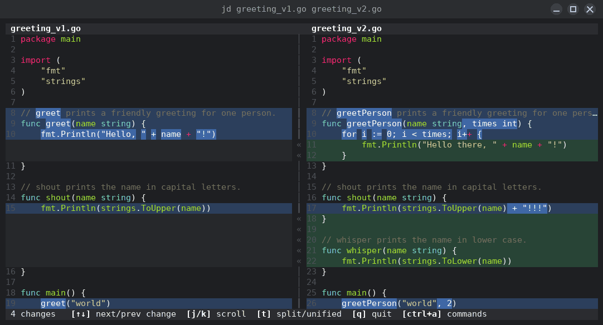

# Jelly Dev

<p align="center"></p>

A terminal diff and merge tool with a JetBrains-style UI: side-by-side panes, colored change blocks and
word-level highlights. It diffs files, directories and the clipboard, shows `git diff` and acts as a three-pane
`git mergetool`, optionally with Claude or Codex resolving the conflicts. The command is `jd`.

- Type: tool
- Tier: 1
- Owner: Roy
- License: MIT
- Stack: Go + Bubble Tea (deliberate deviation from the Python tool default)

## Screenshots

Taken from the [playground](playground/README.md) examples (`python3 playground/screenshots.py` makes them again).


*Compare two files: side by side, with syntax colours and word-level highlights (`t` switches to the unified view, `↓`/`↑` jump between the changes).*


*`jd git`: the changes of a git repository, a file list next to the diff of the selected file.*


*Compare two directories (`jd <dir-a> <dir-b>`): every added, removed and changed file.*


*Three-way merge (`jd merge`, also git's merge tool): ours, result and theirs, per conflict `→` ours, `←` theirs, `b` both, `e` edit.*


*The project window: file tree, file tabs and a vim-style editor with syntax colours; `ctrl+p` projects, `ctrl+t` terminal, `ctrl+f` and `ctrl+g` search.*


*A shell in a panel under the editor (several tabs), like in VS Code.*


*Search in the files of the project (`ctrl+g`), file names with `ctrl+f`.*


*A terminal with 16 colours: jd chooses the `ansi` theme by itself, drawn in reverse video so that it is readable in any palette.*


*`:addlang` lists all languages: pick one and its language server and formatter are installed.*


*The first start asks which languages to install language servers and formatters for.*

## Install

Latest release, checked against the SHA-256 checksum published with it (an integrity check, not a signature):

```
curl -fsSL https://raw.githubusercontent.com/Eutima/jelly-dev/master/scripts/install.sh | sh   # Linux, macOS
irm https://raw.githubusercontent.com/Eutima/jelly-dev/master/scripts/install.ps1 | iex        # Windows (PowerShell)
```

Or with pip (any platform with a wheel: Linux glibc/musl including Alpine, macOS 11 or newer, Windows; x86-64 and arm64):

```
pip install jelly-dev      # puts the jd command on the PATH; pipx install jelly-dev works too
```

The wheel carries the same static binary as the release (no download at install time). A wheel cannot run code when it is
installed, so jd runs the installer script itself the first time it starts interactively (`jd` or `jd <folder>`): the script
that is part of the release, the same as `curl ... | sh`, without downloading jd again. It installs the tools the IDE needs
(the groups below, through your package manager and `sudo` unless you are root) and makes jd git's diff and merge tool
(overwriting existing values). It says so before it starts and runs only once; `jd setup` runs it again. `JD_SKIP_SETUP=1` skips
it, `JD_SKIP_DEPS=1`, `JD_SKIP_GIT_CONFIG=1`, `JD_DEPS` and `JD_DRY_RUN=1` work as for the installer.
Releases are published by the workflow `pypi` (`.github/workflows/pypi.yml`).

The installer:

- puts `jd` in `~/.local/bin` (Windows: `%LOCALAPPDATA%\Programs\jelly-dev`) and removes an old `jelly-dev` binary there;
- adds that directory to your PATH (Linux/macOS: your shell profile; Windows: the user PATH). Reload the shell
  (`exec "$SHELL" -l`, or open a new terminal) so `jd` is found and tab-completes;
- checks the tools the IDE needs and **installs what is missing, without asking** (see below);
- runs `jd install-git --apply`, making `jd` the global `diff.tool` and `merge.tool` of git (overwrites existing values).

Dependencies (groups, all on by default; choose with `JD_DEPS=basics,terminal,runtimes,lsp`, skip with `JD_SKIP_DEPS=1`,
preview with `JD_DRY_RUN=1`):

| Group | Linux / macOS | Windows |
|---|---|---|
| `basics` | git; on Linux a clipboard tool (wl-clipboard or xclip) | git (winget) |
| `terminal` | a terminal emulator for new windows (xterm if none is found); in WSL Windows Terminal (`wt.exe`, via winget) | Windows Terminal |
| `runtimes` | Go, Node.js + npm, Python (pip, pipx), a JDK (also installed when `lsp` is chosen: the servers need them) | Go, Node.js, JDK 21, Python |
| `lsp` | gopls (`go install`), pyright, typescript-language-server (JavaScript and TypeScript), vscode-langservers-extracted (HTML, CSS, JSON), the Angular language server and the formatter prettier (`npm -g`, into `~/.local`), the formatter black (pipx or `pip --user`), jdtls (download) | the same |

System packages are installed with apt, dnf, pacman, zypper, apk or brew (through `sudo` unless you are root) and winget on
Windows. A tool that cannot be installed is reported at the end; jd itself works without them (the language servers are
used by the IDE from milestone 2 on). jdtls is downloaded from download.eclipse.org over
HTTPS as one pinned milestone (1.63.0) and verified against its SHA-256 before it is unpacked; a download that differs is
refused.

**Languages**: the language servers and formatters are installed per language: `python`, `html`, `css`, `json`, `yaml`, `docker` (Dockerfile), `compose` (Docker Compose), `javascript`
(JavaScript and TypeScript), `angular`, `go`, `rust`, `c`, `cpp` (C++), `java`. The first time jd starts in a terminal it asks which ones you work
with (nothing is checked beforehand; `space` toggles, `a` all, `n` none, `enter` installs, `esc` chooses no language, `ctrl+c` means "not now" and it asks again
at the next start) and remembers the answer in `languages.json` in the config folder. Only the tools of those languages (and the runtimes they need) are installed, by the
installer script, and later by the IDE when it starts (`:tools` installs what is missing). Change it any time from the command line,
which needs no root rights:

```
jd install-lsp --list                 # the languages, the chosen ones marked, and which tools are installed
jd install-lsp go java                # install the server and the formatter of Go and Java and add them to the chosen ones
jd install-lsp                        # install what is missing for the chosen languages
jd install-lsp --all                  # every language
jd install-lsp --update               # bring the installed tools of the chosen languages to their newest versions
jd install-lsp --update go python     # the same for the named languages (missing tools are installed)
```

In the IDE `:addlang` (also `:language`) opens a searchable list of all languages: pick one and its language server **and** its
formatter are installed (and the language is added to the chosen ones); a language that is installed already shows "enter updates
it": choosing it brings its language server and formatter to their newest versions (npm and `go install` fetch the latest, pipx or pip
upgrade, `rustup update` for Rust; `clangd` comes from your package manager and is updated there). Rust uses `rustup` (`rustup component add rust-analyzer
rustfmt`), C and C++ use `clangd` from your package manager and `clang-format` (pipx). A missing runtime (Node.js, Python, Go, a JDK,
rustup) is reported; `jd setup` installs those. The installer script takes the same
choice as `JD_LANGS=python,html,css,json,yaml,docker,compose` (also `all` or `none`).

**Python environments**: the Python language server (pyright) is told which interpreter belongs to the project, so imports of the
project's packages resolve in a plain venv, with uv and with the normal system Python. In this order: `JD_PYTHON` (the interpreter
itself), an environment that is active when jd starts (`VIRTUAL_ENV`: venv, virtualenv, `uv run`/activated uv environments, poetry
shell), the uv environment `UV_PROJECT_ENVIRONMENT`, `.venv`, `venv` or `env` in the project (`uv sync`, `uv venv`,
`python -m venv .venv`, poetry or pdm in the project; for a project with several Python folders also the one at the top), an active
conda environment, and for a uv project (`uv.lock`, or `[tool.uv]` in `pyproject.toml`) what `uv python find` says. Without any of
them the Python on the PATH is used. A `pyrightconfig.json` or `[tool.pyright]` with its own `venv` takes precedence in pyright.

Options (environment variables): `JELLY_DEV_VERSION` (for example `v0.2.0`) picks a release, `INSTALL_DIR` changes
the target, `JD_SKIP_GIT_CONFIG=1` leaves the git configuration alone.

Check it: `jd --version`.

## Usage

```
jd <file-a> <file-b>                  compare two files, or two directories
jd --clip <file>                      compare a file with the clipboard (--clip-left: clipboard on the left)
jd git [--staged] [<rev> | <a>..<b>]  browse the changes of the current git repository
jd merge <base> <local> <remote> <merged>   three-way merge (what git mergetool calls)
jd merge <file-a> <file-b>            merge b into a without git; the result is written to a
jd merge <dir-a> <dir-b>              the same for two directories
jd [<folder> | <file>]                open the project window (no argument: the most recent project)
jd install-git [--apply] [--local]    print (or write) the git diff/merge tool settings
```

With `jd` as git's tools: `git difftool`, `git difftool --dir-diff` and `git mergetool`.

Keys in the diff views: `↓`/`↑` next/previous change (in `jd git` and directory diffs with the diff pane focused, past the last or first change of a file they open the next or previous file), `j`/`k` scroll, `g`/`G` top/bottom, `t` split/unified, `q` quit.
Keys in the merge view (conflicts):

| Key | Action |
|---|---|
| `n` / `p` | next / previous change |
| `→` / `←` | add ours / theirs to the change and stay on it (like `»` / `«`); the other arrow adds the second side (= both); the same arrow again removes the side |
| `x` | ignore both sides of an open conflict: keep the lines the result pane shows now (the base; nothing in `jd merge a b`), mark it resolved and stay on it |
| `backspace` / `delete` | cancel the decision for the change (unresolved again) |
| `o` / `t` / `b` / `r` | take ours / theirs / both / base and jump to the next conflict |
| `ctrl+o` / `ctrl+t` | take ours / theirs for all open conflicts |
| `m` | auto-resolve conflicts that are none in fact (whitespace, different words) |
| `a` / `c` | let Claude / Codex resolve all open conflicts (if the CLI is installed) |
| `e` / `enter`, `i`, `d` | open the vim-style editor on the change under the cursor (`i`: on a new line below), delete the line |
| `w` | wrap long lines (default) or cut them with `…` |
| `u` | undo |
| `s` | save (when every conflict is resolved) |
| `q` | quit |

The commands in the footers are written as `[key] action` and can be clicked (when they are not dimmed): a click does what the key
does. This works in the diff, git, directory and merge views, and for the editor commands (`[:w]`, `[:q]`, ...); the one-line
footer of very small terminals is not clickable.

Exit codes: 0 ok (also when there are no differences), 1 runtime error, 2 usage error. A merge exits 0 only after saving.

`playground/` has sample files, two directory trees, merge inputs and a script that creates git repositories with
local changes and with a merge stopped on conflicts: see `playground/README.md`.

## Project window (work in progress)

`jd` with no argument opens the **most recent project** (a folder) in the project window: the file tree on the left and a
vim-style editor on the right; with no history it shows a welcome screen with the recent projects (`enter` open here,
`w` open in a new window, `o` type a folder, `d` forget, `q` quit). `jd <folder>` opens that folder, `jd <file>` opens the
file in its project (the git root, else its folder); a name that does not exist yet starts a new file. The list of recent
projects, and for each one the file and cursor that were open, is kept in `<user config dir>/jd/projects.json`
(`JD_CONFIG_DIR` changes the folder), so the next `jd` continues where you stopped.

**Top bar**: the first line of the project window has the buttons *Project* (`ctrl+p`), *Terminal* (`ctrl+t`) and, in a git
repository only, *Diff* (the git changes of the project as in `jd git`, `D` in the tree or `:diff`; `q` returns to the editor; save
first, the diff shows what is on disk). `ctrl+p` and `ctrl+t` work in the tree and in the editor's normal mode (`ctrl+o` is the way
back after `gd`/`gr`). *Terminal* opens a shell in the project in a panel under the editor, like VS Code. Everything you type goes
to the shell; `ctrl+]` (or a click on the editor) gives the focus back, `ctrl+t` or the *Terminal* button hides the panel (the shells
keep running). The panel has **tabs**, one shell each: `alt+t` or `[+]` (or `:terminal new`) opens another, a click or `alt+1` … `alt+9`
chooses one, `alt+w` or `[×]` ends the shown one; a shell that exits closes its tab, the last one takes the panel with it. Windows has no embedded terminal yet: there the shell runs in place of the window until
you `exit`.

**File tabs**: every file you open from the tree, a search or `gd`/`gr` gets a tab above the editor (an open file is shown, not
opened twice); each tab keeps its own text, undo history and cursor. `gt` / `gT` (or `:tabn` / `:tabp`, `:bn` / `:bp`) show the next /
previous tab, a click on a name shows it, a click on `×` (or `:bd`, `:tabclose`) closes it. `:q`, `:wq` and `ctrl+d` close the tab, the
last one leaves; `:wa` writes all files, `:qa` leaves when nothing is unsaved and `:qa!` anyway. The open tabs come back with the project.
The footers and bars adapt to the width: on a narrow terminal the last commands lose their label (the `[key]` stays clickable) and then
drop out, the first ones stay.

**Narrow terminals**: in the project window the status line of the editor and the hints under the tree wrap onto a second line when
the commands do not fit (labels shrink to the `[key]` and then the last commands drop out only when two lines are not enough), and
long messages (a file path, an error) wrap at the spaces over up to three lines instead of ending in "…". The other views (diff, git,
merge) shorten and drop the last commands.

**Unsaved changes**: closing a tab or switching project asks *Save / Discard / Cancel* (`s`, `d`, `c`,
`←/→` and `enter`, or a click).

**Switching projects**: `ctrl+p` (or `P` in the tree), `:project` (without a folder) or `:projects` / `:recent` open the list of
recent projects; `enter` opens the chosen one in a new window, `o` lets you type a folder (with `tab` completion; also opened in a new window), `d`
forgets an entry, `esc` closes the list. `:project <folder>` switches this window directly (the folder may be relative to the project or start
with `~`); `:project!` discards unsaved changes, otherwise they block the switch (E37). The file and cursor that were open are
stored first and come back when you return to a project; the language servers follow the window to the new project.

**New windows** (like JetBrains): `w` in the tree on a folder, `:window [folder]` in the editor and `w` on the welcome screen
start a new terminal window running `jd` on that folder. jd uses tmux (`tmux new-window`) when it runs inside tmux, Windows
Terminal when it runs in **WSL** or Windows, Terminal.app on macOS, and on Linux the first terminal it finds
(x-terminal-emulator, gnome-terminal, konsole, xfce4-terminal, kitty, wezterm, alacritty, foot, xterm). Set `JD_TERMINAL`
(for example `JD_TERMINAL="kitty"`) to choose another one; jd and the folder are appended to it. The value is split at spaces (no quoting), so a path with spaces needs a wrapper script. Where no terminal can be started (a container, an ssh session) a project
opens in the current window instead.

Closing: `ctrl+d` (like `ctrl+c`) from the tree and from the editor's normal mode always asks first, even when nothing changed: a box
asks *Quit Jelly-Dev?* (from the editor with several tabs: *Close <file>?*), `y` or `enter` closes, `n` or `esc` stays, and pressing
`ctrl+d` again also closes. A file with unsaved changes asks *Save / Discard / Cancel* instead, for every changed tab when quitting.
After a jump (`gd`, `gr`) `ctrl+c` and `ctrl+d` still go back first; in insert mode `ctrl+c` only returns to normal mode, and in the
terminal panel both belong to the shell. `:q`, `:wq` and `q` in the tree are explicit and close without the box.

Welcome screen "open folder" (`o`): type a path and press `tab` to complete it (a single match completes the whole folder, several
matches complete their common part, further presses walk through them; `shift+tab` goes back). The matching folders are listed
while you type and can be chosen with the arrows; `enter` opens the folder here, `ctrl+w` in a new window.

Tree keys: `j`/`k` move, `enter`/`o` open a file or toggle a folder, `h`/`l` collapse/expand, `R` refresh, `w` new window,
`ctrl+e` or `tab` switch to the editor, `q` quit (`ctrl+e` switches back to the tree). Entries of `.git` and the root
`.gitignore` (names and globs) are hidden. The mouse works in the tree, the editor and the footers.

Editor: normal, insert and visual mode with the keys listed under "Merge" (the same engine), line numbers, syntax highlighting,
scrolling, `:w [file]`, `:wq`, `:x`, `:q`, `:q!`, `:e[!] file`, `:set nu|nonu`, `:{n}`. Files are written atomically with
their line endings. Planned (branch `feature/vim-ide`): tabs and splits, the rest of vim, diagnostics, a terminal panel.

**Search in the open file** like vim: `/pattern` forwards, `?pattern` backwards (a regular expression; a pattern that is none is searched
literally; start it with `\c` to ignore case), `enter` jumps, `n` / `N` repeat in the same / the opposite direction and wrap around the
end of the file, an empty `/` repeats the last pattern, and `:noh` removes the highlight of the matches.

**Search** (`ctrl+f` file names, `ctrl+g` file content; in the tree also `/`; `:find [name]`, `:grep [text]`): a full-screen search over
the project. `tab` switches between the two. File names are matched fuzzily (`uied` finds `internal/ui/editor.go`; several words must all
match; names rank above paths). Content search starts while you type (smart case: lower case ignores case, a capital letter makes it
case sensitive; `ctrl+r` switches to regular expressions) and lists `file:line  text` with the match highlighted. `enter` or a click
opens the file at the match, `esc` (or `ctrl+d`) closes. `node_modules`, `.venv`, `venv`, `__pycache__`, `.tox`, `.gradle`, `.idea`,
`.git`, caches and everything in the project's `.gitignore` or an optional `.jdignore` (same patterns) are skipped, as are binary
files and files over 1 MiB.

**Language servers** (started when first needed, per project): `gd` jumps to the definition of the symbol under the cursor, `gr` lists
its references (`j`/`k`, `enter` or a click jump), `ctrl+o` returns to where the last jump started (also after a search jump), also
across files; so do `ctrl+c` and `ctrl+d` in normal mode, one step at a time, and only when there is no jump left to undo they close the
window (unsaved changes block going back to another file, E37). `:format` (`:fmt`) formats the file as one undoable change: with the file type's formatter command when installed (Go: `gofmt`;
HTML, CSS, SCSS, JavaScript, TypeScript, JSON: `prettier`; Python: `black`), otherwise with the language server (Java is formatted
by jdtls). When no formatter is found for the file (no server for the file type, a server that cannot format, a missing server), a
searchable list of formatters opens (gofmt, goimports, prettier, black, ruff, shfmt, clang-format, rustfmt, jq, xmllint, yamlfmt, taplo ...;
the ones for the file type come first, missing ones are dim): type to narrow it, `enter` formats with the chosen one and remembers it
for that file type once its result was applied (`formatters.json` in the config folder; delete the entry there to forget it), `esc` cancels. `ctrl+space` (or `ctrl+n`) in insert mode opens the completion popup with the server's
suggestions and the words of the file as a fallback: typing narrows it, `ctrl+n`/`ctrl+p` or the arrows choose, `tab` or `enter`
accept, `esc` closes it. Defaults: gopls (Go), typescript-language-server (JavaScript, TypeScript, JSX), pyright (Python),
vscode-html/css/json-language-server, jdtls (Java); the installer sets them up. Add or change servers in
`<config dir>/jd/lsp.json`: `{"servers": [{"name": "rust", "command": ["rust-analyzer"], "extensions": [".rs"], "languageId": "rust",
"rootMarkers": ["Cargo.toml"], "formatter": ["rustfmt", "--emit", "stdout"]}]}` (an entry with the name of a default replaces it).

**Tools are installed for you**: when a project window opens, jd checks for the language servers and formatters (gopls,
typescript-language-server, pyright, the HTML/CSS/JSON servers, the Angular language server, jdtls,
prettier, black) and **installs what is missing in the background**, one after the other, with the language's own tool (`go
install`, `npm install -g --prefix ~/.local`, `pipx` or `pip --user`, or a download); the progress shows in the status line
and the result when it is done. A runtime that is missing (Go, Node.js, Python, Java) is reported, not installed: jd never
asks for root rights, the installer installs runtimes. A tool that failed is tried again after a day; `:tools` tries all missing
ones now and `:tools status` lists what is missing. `JD_NO_AUTO_INSTALL=1` turns the start-up installation off. Tools end up in
`~/.local/bin` (and Go's bin folder), which jd adds to its own PATH. Angular templates (`*.component.html`) use the Angular
language server (it finds `typescript` and `@angular/language-service` in the project's `node_modules` or the global ones).

**Clipboard**: copied and deleted text (`y`, `d`, `x`, ...) is also put on the system clipboard, and `p` pastes what is on it, so text
moves between the editor and other programs (WSL and Windows use PowerShell, macOS pbcopy/pbpaste, Linux wl-clipboard, xclip or
xsel). Text pasted by the terminal is inserted as text, never run as vim commands. `ctrl+d` leaves insert and visual mode like `ctrl+c`.

## Details

### Status

Done: file diff, word-level highlights, unified view, clipboard compare, git changes, directory diff, three-pane
merge, git tool setup, themes (dark, light, mono), syntax highlighting. Releases are published automatically.

### Diff, clipboard, git and directories

Usage: `jd <file-a> <file-b>`. Flags must come before file names.
Exit codes: 0 ok (also when there are no differences), 1 runtime error, 2 usage error.
Clipboard: `jd --clip <file>` (clipboard on the right) or `--clip-left`. Reads via PowerShell on
WSL/Windows, `pbpaste` on macOS, `wl-paste`/`xclip`/`xsel` on Linux.
Git: `jd git [--staged] [<rev> | <a>..<b>] [-- <path>...]` shows a changed-file list (working tree vs HEAD incl.
untracked files by default) next to the diff of the selected file. In the list: `j`/`k` select, `enter` focus the
diff, `tab` switch focus, `esc` back. Three-dot ranges are not supported; flags must precede the revision.
Directories: `jd <dir-a> <dir-b>` lists the files that differ (modified, only left, only right) with the same
list-plus-diff view; use it from git with `git difftool --dir-diff` (its temporary directories hold links to the working tree files, which
are followed). Compared are regular files and links to regular files; links to directories, dangling links, special
files and `.git` directories are skipped.
Keys (diff): `↓`/`↑` next/previous change, `j`/`k` scroll, `g`/`G` top/bottom, `t` split/unified, mouse wheel, `q` quit.
The mouse is captured for wheel scrolling; hold Shift while dragging to select text in most terminals.

### Merge

Merge: `jd merge <base> <local> <remote> <merged>` shows ours | result | theirs. Non-conflicting changes are
merged automatically; conflicts start with the base lines. The result pane has a line cursor:

- `j`/`k`/arrows move the cursor (the change under it is selected), `n`/`p` jump to the next/previous change.
- Gutter buttons (mouse, three-pane layout only): `»` applies ours, `«` applies theirs; applying the second side of a
  change gives both. `×` discards that side (the other side stays, or the base when none is left), like JetBrains.
  A click stays on the change instead of jumping to the next conflict, so you can apply both and edit by hand.
  A button disappears (and is no longer clickable) once its action is done, e.g. `»` after ours was applied.
- `ctrl+→` or `ctrl+o` / `ctrl+←` or `ctrl+t` take ours / theirs for every conflict that is still unresolved (decided conflicts and automatic
  merges stay; one `u` undoes it).
- `→` / `←` work like the gutter buttons: they add ours / theirs to the selected change and stay on it, so the other side can
  still be added (the second arrow gives both); the same arrow again removes that side (like `×`) and `backspace` or `delete`
  cancels the whole decision. Move on with `n`. `o` takes ours, `t` theirs, `b` both and `r` reverts to the base, each
  followed by a jump to the next unresolved conflict. `x` ignores both sides of an open conflict (keeps the lines shown
  in the result now) and stays on it; unlike `r` it only applies to open conflicts and does not jump.
- `m` (auto-resolve) resolves every conflict that is none in fact: a change of whitespace only, or both sides editing
  different words of the same lines. Real conflicts stay open; one `u` undoes the whole step.
- `a` asks Claude (`claude` CLI) and `c` asks Codex (`codex` CLI) to resolve every conflict that is still open; a
  key is only active when its CLI is installed and on the PATH. The answer is applied as hand-edited result lines
  (review it, one `u` undoes the whole answer). **The three versions of every open conflict are sent to the
  assistant's service**, so do not use it on files that must not leave your machine. The assistant runs in an empty
  temporary directory without tools (Claude) or in a read-only sandbox (Codex) and times out after 5 minutes; `q`
  cancels a running request. Needs a logged-in CLI.
- `e` or `enter` opens a vim-style editor on the **change under the cursor** (`i` opens it on a new empty line below the
  cursor, in insert mode); `d` deletes the line under the cursor. The editor takes the whole screen and starts in
  normal mode. The lines of the change are editable; all other lines of the result are shown above and below,
  dimmed and read-only: the cursor can walk over them (`j`/`k`, arrows, `pgup`/`pgdn`, `gg`/`G`; the status line says
  `READ-ONLY`) but any attempt to change them is refused:
  - motions: `h j k l` and arrows, `w b e`, `0 ^ $`, `gg G` and `{n}G`, `ctrl+u`, `pgup`/`pgdn`, counts (`3j`, `2dw`);
  - insert mode: `i a I A o O`; `esc` returns to normal mode;
  - changes: `x X D C`, operators `d c y` with a motion (`dd cc yy dw cw d$ dj dG ...`), `p P`, `r{char}`, `J`, `~`, `u`, `ctrl+r`;
  - visual mode: `v` (characters) and `V` (lines), then `d x y c`;
  - Ex commands: `:w` applies the text to the merge and stays, `:wq` or `:x` applies and leaves, `:q` leaves (refuses
    while there are unapplied changes), `:q!` discards them, `:{n}` goes to line n. `ctrl+d` works like `q` in the merge view: it leaves right away when
    nothing changed, otherwise it asks whether to apply (`y`), discard (`n`) or keep editing (any other key).

  Not supported: `.`, macros, named registers, search, text objects. Applying stores the lines in the change, which then
  counts as resolved; one `u` in the merge view undoes a whole `:w`.
- `u` undoes the last step (also edits, deletions and insertions), `s` saves (only when every conflict is resolved),
  `q`, `ctrl+c` or `ctrl+d` quits (asks before discarding an unsaved result), `v` switches the shown pane on narrow terminals.

Layout: a header shows the document, the number of conflicts remaining, the save state (`Modified`, `Saved`,
`Save failed`), the position (`Conflict 2 of 5`) and a progress bar; the result pane (40%) sits between ours and
theirs. The edge column marks each change: `▌` the selected change, `!` unresolved conflict, `✓` resolved, `~` merged
automatically. Below 72 columns one pane is shown at a time (`v` switches pane); below 10 rows header and footer shrink
to one line each. The footer shows the actions for the selected change and the shortcuts in groups; unavailable ones
are dimmed.

Without git: `jd merge <file-a> <file-b>` merges file b into file a and writes the result to file a (atomically,
with a's line endings). There is no common ancestor, so every difference is a conflict you decide (`»`/`«`/`×`, `o`/`t`/`b`,
`ctrl+o` keeps all of a, `ctrl+t` takes all of b); identical files print "no differences" and write nothing.

Directories: `jd merge <dir-a> <dir-b>` lists the files that differ (`M`, `(only in a)`, `(only in b)`);
`enter` opens one in the merge view and `s` saves it into directory a (a file only in b is created there; for a file only
in a you decide per hunk, `ctrl+o` keeps it). `q` returns to the list, where `✓` marks merged files. Directory b is
never changed and nothing is deleted.

The result is written atomically with the line endings of the local file and a final newline; the exit code is 0 only
after saving.

Use as git tool: `jd install-git` prints the `git config` commands, `--apply` writes them (`--local` for
the current repository only), then use `git difftool` and `git mergetool`.

### Build from source and test

```
go build -o bin/jd ./cmd/jelly-dev
go test ./...
```

Requires Go 1.24 (the toolchain is fetched automatically by Go >= 1.21).

Git mode runs the `git` command, so the repository's own git configuration applies; do not open untrusted
repositories with it. Symbolic links are shown as their target path and are never followed.

Inputs must be regular files (or symbolic links to them): pipes such as `<(command)` are rejected.

Syntax highlighting (library: [chroma](https://github.com/alecthomas/chroma), MIT) is chosen by file name and shown in
the diff, clipboard, git, directory and merge views (in the merge view the result pane is re-highlighted after every
choice): monokai colors in the dark theme, github colors in the light theme, none in mono. Changed words keep their
own highlight. Files over 512 KiB and files without a known lexer are not highlighted.

### Known limitations of the terminal UI

- On terminals that do not answer the background-color query (some serial consoles and test harnesses) every start,
  including `jd --version`, waits about 5 seconds. This comes from bubbletea v1 (it queries the terminal while
  initializing) and goes away on terminals such as xterm, iTerm2, kitty, Alacritty, WezTerm; tmux and screen are skipped.

### Build and release

`jd --version` (or `jd version`, only as the sole argument; use `./version` for a file of that name) prints the
version. A plain `go build` reports the version Go records for the build (a pseudo-version with the commit, or `dev`
without build information, or the tag when installed with `go install ...@vX.Y.Z`); release builds get the version
linked in:

```
go build -trimpath -ldflags "-X main.version=0.1.0" -o bin/jd ./cmd/jelly-dev
goreleaser release --snapshot --clean      # archives for Linux, macOS and Windows (amd64, arm64) in dist/
```

CI (`.github/workflows/ci.yml`) cross-compiles all six targets and runs `goreleaser check`. The actions are pinned
to commit SHAs and GoReleaser to an exact version; Dependabot (`.github/dependabot.yml`) proposes updates weekly
with Conventional Commit titles.

Every push to `master` runs the tests (`.github/workflows/release.yml`) and then creates a release:
`scripts/next-version.sh` derives the next `vX.Y.Z` tag from the Conventional Commits since the last tag
(`feat` = minor, `fix`/`perf` = patch, `!` or `BREAKING CHANGE` = major) and GoReleaser publishes the archives and
`checksums.txt` to GitHub. Pushes with only `chore`, `docs`, `test`, `ci` or `refactor` commits create no release.

### Config

Environment variables (see `.env.example`):

- `JELLY_DEV_THEME`: `auto` (default), `dark`, `light`, `ansi`, `contrast` or `mono`. `auto` looks at the terminal: no colours gives `mono`
  (bold = added, strikethrough = deleted, reverse video = changed words), 16 colours gives `ansi`, 256 or more colours gives `dark` or
  `light` by the background of the terminal. `ansi` sets no fixed background (a terminal with 16 colours maps colours to its own palette, which
  can turn text into grey on grey): bars and selections are drawn in reverse video, changes in foreground colours of the palette.
  `contrast` is the same without any dim text, bold where it matters. `:theme <name>` in the IDE switches at once (`:theme` lists them).
- `NO_COLOR`: any non-empty value selects `mono` unless `JELLY_DEV_THEME` is set.

### Known limitations

- A missing trailing newline at the end of a file is not shown as a difference.
- Binary detection only checks for NUL bytes (UTF-16 files are shown as garbage); files and git blobs are limited to 64 MiB.
- While a file loads in the list views a wobbling jelly is shown; slow operations before the UI opens (listing a large directory or repository, reading the clipboard) show a small jelly wave on stderr after 300 ms (only on an interactive terminal).
- In git mode files load in the background ("Loading ..." is shown); selecting another file cancels the load in progress, including a running `git` process, so only the latest selection is loaded. Plain `jd a b` still reads both files before the UI opens.
