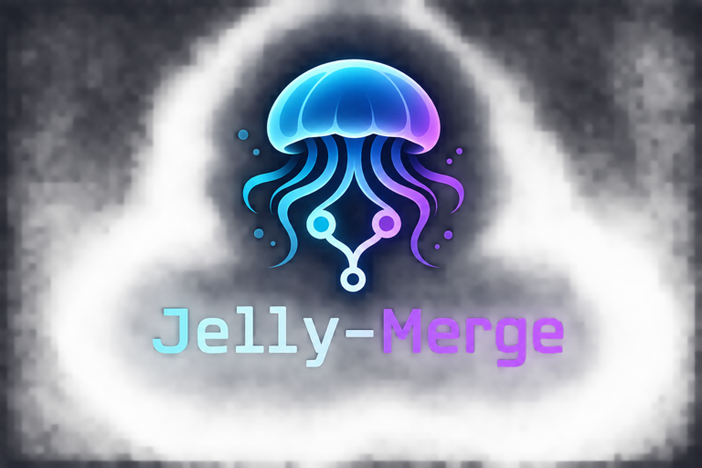

# jelly-diff

<p align="center"></p>

The merge view is branded **Jelly-Merge**.

A terminal diff and merge tool with a JetBrains-style UI: side-by-side panes, colored change
blocks and word-level highlights. It will diff files, diff the clipboard, show `git diff` and
act as a three-pane `git mergetool`.

- Type: tool
- Tier: 1
- Owner: Roy
- Stack: Go + Bubble Tea (deliberate deviation from the Python tool default)

## Status

Done: file diff, word-level highlights, unified view, clipboard compare, git changes, directory diff, three-pane
merge, git tool setup, themes (dark, light, mono), syntax highlighting. Open: release packaging.

Usage: `jelly-diff <file-a> <file-b>`. Flags must come before file names.
Exit codes: 0 ok (also when there are no differences), 1 runtime error, 2 usage error.
Clipboard: `jelly-diff --clip <file>` (clipboard on the right) or `--clip-left`. Reads via PowerShell on
WSL/Windows, `pbpaste` on macOS, `wl-paste`/`xclip`/`xsel` on Linux.
Git: `jelly-diff git [--staged] [<rev> | <a>..<b>] [-- <path>...]` shows a changed-file list (working tree vs HEAD incl.
untracked files by default) next to the diff of the selected file. In the list: `j`/`k` select, `enter` focus the
diff, `tab` switch focus, `esc` back. Three-dot ranges are not supported; flags must precede the revision.
Directories: `jelly-diff <dir-a> <dir-b>` lists the files that differ (modified, only left, only right) with the same
list-plus-diff view; use it from git with `git difftool --dir-diff` (its temporary directories hold links to the working tree files, which
are followed). Compared are regular files and links to regular files; links to directories, dangling links, special
files and `.git` directories are skipped.
Keys (diff): `n`/`p` next/previous change, `j`/`k` scroll, `g`/`G` top/bottom, `t` split/unified, mouse wheel, `q` quit.
The mouse is captured for wheel scrolling; hold Shift while dragging to select text in most terminals.

Merge: `jelly-diff merge <base> <local> <remote> <merged>` shows ours | result | theirs. Non-conflicting changes are
merged automatically; conflicts start with the base lines. The result pane has a line cursor:

- `j`/`k`/arrows move the cursor (the change under it is selected), `n`/`p` jump to the next/previous change.
- `o` takes ours, `t` theirs, `b` both, `r` reverts the change to the base.
- `m` (auto-resolve) resolves every conflict that is none in fact: a change of whitespace only, or both sides editing
  different words of the same lines. Real conflicts stay open; one `u` undoes the whole step.
- `e` or `enter` edits the line under the cursor in place (`enter` applies, `esc` cancels, arrows/home/end move,
  `ctrl+u`/`ctrl+k` delete to the start/end of the line), `d` deletes the line, `i` inserts a new line below it and
  opens it for editing (`esc` removes it again). A block edited by hand counts as resolved.
- `u` undoes the last step (also edits, deletions and insertions), `s` saves (only when every conflict is resolved),
  `q` or `ctrl+c` quits (asks before discarding an unsaved result), `v` switches the shown pane on narrow terminals.

Layout: a header shows the document, the number of conflicts remaining, the save state (`Modified`, `Saved`,
`Save failed`), the position (`Conflict 2 of 5`) and a progress bar; the result pane (40%) sits between ours and
theirs. The edge column marks each change: `▌` the selected change, `!` unresolved conflict, `✓` resolved, `~` merged
automatically. Below 72 columns one pane is shown at a time (`v` switches pane); below 10 rows header and footer shrink
to one line each. The footer shows the actions for the selected change and the shortcuts in groups; unavailable ones
are dimmed.

The result is written atomically with the line endings of the local file and a final newline; the exit code is 0 only
after saving.
Use as git tool: `jelly-diff install-git` prints the `git config` commands, `--apply` writes them (`--local` for
the current repository only), then use `git difftool` and `git mergetool`.

## Try it

`playground/` has sample files, two directory trees, merge inputs and a script that creates git repositories with local
changes and with a merge stopped on conflicts: see `playground/README.md`.

## Run

```
go build -o bin/jelly-diff ./cmd/jelly-diff
go test ./...
```

Requires Go 1.24 (the toolchain is fetched automatically by Go >= 1.21).

Git mode runs the `git` command, so the repository's own git configuration applies; do not open untrusted
repositories with it. Symbolic links are shown as their target path and are never followed.

Inputs must be regular files (or symbolic links to them): pipes such as `<(command)` are rejected.

Syntax highlighting (library: [chroma](https://github.com/alecthomas/chroma), MIT) is chosen by file name and shown in
the diff, clipboard, git, directory and merge views (in the merge view the result pane is re-highlighted after every
choice): monokai colors in the dark theme, github colors in the light theme, none in mono. Changed words keep their
own highlight. Files over 512 KiB and files without a known lexer are not highlighted.

## Known limitations of the terminal UI

- On terminals that do not answer the background-color query (some serial consoles and test harnesses) every start,
  including `jelly-diff --version`, waits about 5 seconds. This comes from bubbletea v1 (it queries the terminal while
  initializing) and goes away on terminals such as xterm, iTerm2, kitty, Alacritty, WezTerm; tmux and screen are skipped.

## Build and release

`jelly-diff --version` (or `jelly-diff version`, only as the sole argument; use `./version` for a file of that name) prints the
version. A plain `go build` reports the version Go records for the build (a pseudo-version with the commit, or `dev`
without build information, or the tag when installed with `go install ...@vX.Y.Z`); release builds get the version
linked in:

```
go build -trimpath -ldflags "-X main.version=0.1.0" -o bin/jelly-diff ./cmd/jelly-diff
goreleaser release --snapshot --clean      # archives for Linux, macOS and Windows (amd64, arm64) in dist/
```

CI (`.github/workflows/ci.yml`) cross-compiles all six targets and runs `goreleaser check`. The actions are pinned
to commit SHAs and GoReleaser to an exact version; Dependabot (`.github/dependabot.yml`) proposes updates weekly
with Conventional Commit titles. Publishing is switched off
in `.goreleaser.yaml` until a release target is chosen.

## Config

Environment variables (see `.env.example`):

- `JELLY_DIFF_THEME`: `dark` (default), `light` or `mono` (no colors: bold = added, strikethrough = deleted, reverse video = changed words).
- `NO_COLOR`: any non-empty value selects `mono` unless `JELLY_DIFF_THEME` is set.

## Known limitations

- A missing trailing newline at the end of a file is not shown as a difference.
- Binary detection only checks for NUL bytes (UTF-16 files are shown as garbage); files and git blobs are limited to 64 MiB.
- While a file loads in the list views a wobbling jelly is shown; slow operations before the UI opens (listing a large directory or repository, reading the clipboard) show a small jelly wave on stderr after 300 ms (only on an interactive terminal).
- In git mode files load in the background ("Loading ..." is shown); selecting another file cancels the load in progress, including a running `git` process, so only the latest selection is loaded. Plain `jelly-diff a b` still reads both files before the UI opens.
