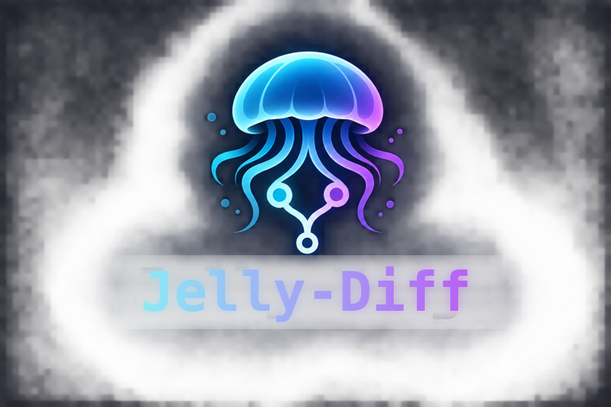

# Jelly Diff

<p align="center"></p>

A terminal diff and merge tool with a JetBrains-style UI: side-by-side panes, colored change blocks and
word-level highlights. It diffs files, directories and the clipboard, shows `git diff` and acts as a three-pane
`git mergetool`, optionally with Claude or Codex resolving the conflicts. The command is `jd`.

- Type: tool
- Tier: 1
- Owner: Roy
- License: MIT
- Stack: Go + Bubble Tea (deliberate deviation from the Python tool default)

## Install

Latest release, checked against the SHA-256 checksum published with it (an integrity check, not a signature):

```
curl -fsSL https://raw.githubusercontent.com/Eutima/jelly-diff/master/scripts/install.sh | sh   # Linux, macOS
irm https://raw.githubusercontent.com/Eutima/jelly-diff/master/scripts/install.ps1 | iex        # Windows (PowerShell)
```

The installer:

- puts `jd` in `~/.local/bin` (Windows: `%LOCALAPPDATA%\Programs\jelly-diff`) and removes an old `jelly-diff` binary there;
- adds that directory to your PATH (Linux/macOS: your shell profile; Windows: the user PATH). Reload the shell
  (`exec "$SHELL" -l`, or open a new terminal) so `jd` is found and tab-completes;
- runs `jd install-git --apply`, making `jd` the global `diff.tool` and `merge.tool` of git (overwrites existing values).

Options (environment variables): `JELLY_DIFF_VERSION` (for example `v0.2.0`) picks a release, `INSTALL_DIR` changes
the target, `JD_SKIP_GIT_CONFIG=1` leaves the git configuration alone.

Check it: `jd --version`.

## Usage

```
jd <file-a> <file-b>                  compare two files, or two directories
jd --clip <file>                      compare a file with the clipboard (--clip-left: clipboard on the left)
jd git [--staged] [<rev> | <a>..<b>]  browse the changes of the current git repository
jd merge <base> <local> <remote> <merged>   three-way merge (what git mergetool calls)
jd merge <file-a> <file-b>            merge b into a without git; the result is written to a
jd merge <dir-a> <dir-b>              the same for two directories
jd install-git [--apply] [--local]    print (or write) the git diff/merge tool settings
```

With `jd` as git's tools: `git difftool`, `git difftool --dir-diff` and `git mergetool`.

Keys in the diff views: `n`/`p` next/previous change, `j`/`k` scroll, `g`/`G` top/bottom, `t` split/unified, `q` quit.
Keys in the merge view (conflicts):

| Key | Action |
|---|---|
| `n` / `p` | next / previous change |
| `→` / `←` | add ours / theirs to the change and stay on it (like `»` / `«`); the other arrow adds the second side (= both); the same arrow again removes the side |
| `x` | ignore both sides of an open conflict: keep the lines the result pane shows now (the base; nothing in `jd merge a b`), mark it resolved and stay on it |
| `backspace` / `delete` | cancel the decision for the change (unresolved again) |
| `o` / `t` / `b` / `r` | take ours / theirs / both / base and jump to the next conflict |
| `ctrl+o` / `ctrl+t` | take ours / theirs for all open conflicts |
| `m` | auto-resolve conflicts that are none in fact (whitespace, different words) |
| `a` / `c` | let Claude / Codex resolve all open conflicts (if the CLI is installed) |
| `e` / `enter`, `i`, `d` | open the vim-style editor on the change under the cursor (`i`: on a new line below), delete the line |
| `w` | wrap long lines (default) or cut them with `…` |
| `u` | undo |
| `s` | save (when every conflict is resolved) |
| `q` | quit |

The commands in the footers are written as `[key] action` and can be clicked (when they are not dimmed): a click does what the key
does. This works in the diff, git, directory and merge views, and for the editor commands (`[:w]`, `[:q]`, ...); the one-line
footer of very small terminals is not clickable.

Exit codes: 0 ok (also when there are no differences), 1 runtime error, 2 usage error. A merge exits 0 only after saving.

`playground/` has sample files, two directory trees, merge inputs and a script that creates git repositories with
local changes and with a merge stopped on conflicts: see `playground/README.md`.

## Details

### Status

Done: file diff, word-level highlights, unified view, clipboard compare, git changes, directory diff, three-pane
merge, git tool setup, themes (dark, light, mono), syntax highlighting. Releases are published automatically.

### Diff, clipboard, git and directories

Usage: `jd <file-a> <file-b>`. Flags must come before file names.
Exit codes: 0 ok (also when there are no differences), 1 runtime error, 2 usage error.
Clipboard: `jd --clip <file>` (clipboard on the right) or `--clip-left`. Reads via PowerShell on
WSL/Windows, `pbpaste` on macOS, `wl-paste`/`xclip`/`xsel` on Linux.
Git: `jd git [--staged] [<rev> | <a>..<b>] [-- <path>...]` shows a changed-file list (working tree vs HEAD incl.
untracked files by default) next to the diff of the selected file. In the list: `j`/`k` select, `enter` focus the
diff, `tab` switch focus, `esc` back. Three-dot ranges are not supported; flags must precede the revision.
Directories: `jd <dir-a> <dir-b>` lists the files that differ (modified, only left, only right) with the same
list-plus-diff view; use it from git with `git difftool --dir-diff` (its temporary directories hold links to the working tree files, which
are followed). Compared are regular files and links to regular files; links to directories, dangling links, special
files and `.git` directories are skipped.
Keys (diff): `n`/`p` next/previous change, `j`/`k` scroll, `g`/`G` top/bottom, `t` split/unified, mouse wheel, `q` quit.
The mouse is captured for wheel scrolling; hold Shift while dragging to select text in most terminals.

### Merge

Merge: `jd merge <base> <local> <remote> <merged>` shows ours | result | theirs. Non-conflicting changes are
merged automatically; conflicts start with the base lines. The result pane has a line cursor:

- `j`/`k`/arrows move the cursor (the change under it is selected), `n`/`p` jump to the next/previous change.
- Gutter buttons (mouse, three-pane layout only): `»` applies ours, `«` applies theirs; applying the second side of a
  change gives both. `×` discards that side (the other side stays, or the base when none is left), like JetBrains.
  A click stays on the change instead of jumping to the next conflict, so you can apply both and edit by hand.
  A button disappears (and is no longer clickable) once its action is done, e.g. `»` after ours was applied.
- `ctrl+→` or `ctrl+o` / `ctrl+←` or `ctrl+t` take ours / theirs for every conflict that is still unresolved (decided conflicts and automatic
  merges stay; one `u` undoes it).
- `→` / `←` work like the gutter buttons: they add ours / theirs to the selected change and stay on it, so the other side can
  still be added (the second arrow gives both); the same arrow again removes that side (like `×`) and `backspace` or `delete`
  cancels the whole decision. Move on with `n`. `o` takes ours, `t` theirs, `b` both and `r` reverts to the base, each
  followed by a jump to the next unresolved conflict. `x` ignores both sides of an open conflict (keeps the lines shown
  in the result now) and stays on it; unlike `r` it only applies to open conflicts and does not jump.
- `m` (auto-resolve) resolves every conflict that is none in fact: a change of whitespace only, or both sides editing
  different words of the same lines. Real conflicts stay open; one `u` undoes the whole step.
- `a` asks Claude (`claude` CLI) and `c` asks Codex (`codex` CLI) to resolve every conflict that is still open; a
  key is only active when its CLI is installed and on the PATH. The answer is applied as hand-edited result lines
  (review it, one `u` undoes the whole answer). **The three versions of every open conflict are sent to the
  assistant's service**, so do not use it on files that must not leave your machine. The assistant runs in an empty
  temporary directory without tools (Claude) or in a read-only sandbox (Codex) and times out after 5 minutes; `q`
  cancels a running request. Needs a logged-in CLI.
- `e` or `enter` opens a vim-style editor on the **change under the cursor** (`i` opens it on a new empty line below the
  cursor, in insert mode); `d` deletes the line under the cursor. The editor takes the whole screen and starts in
  normal mode. The lines of the change are editable; all other lines of the result are shown above and below,
  dimmed and read-only: the cursor can walk over them (`j`/`k`, arrows, `pgup`/`pgdn`, `gg`/`G`; the status line says
  `READ-ONLY`) but any attempt to change them is refused:
  - motions: `h j k l` and arrows, `w b e`, `0 ^ $`, `gg G` and `{n}G`, `ctrl+u`, `pgup`/`pgdn`, counts (`3j`, `2dw`);
  - insert mode: `i a I A o O`; `esc` returns to normal mode;
  - changes: `x X D C`, operators `d c y` with a motion (`dd cc yy dw cw d$ dj dG ...`), `p P`, `r{char}`, `J`, `~`, `u`, `ctrl+r`;
  - visual mode: `v` (characters) and `V` (lines), then `d x y c`;
  - Ex commands: `:w` applies the text to the merge and stays, `:wq` or `:x` applies and leaves, `:q` leaves (refuses
    while there are unapplied changes), `:q!` discards them, `:{n}` goes to line n. `ctrl+d` works like `q` in the merge view: it leaves right away when
    nothing changed, otherwise it asks whether to apply (`y`), discard (`n`) or keep editing (any other key).

  Not supported: `.`, macros, named registers, search, text objects. Applying stores the lines in the change, which then
  counts as resolved; one `u` in the merge view undoes a whole `:w`.
- `u` undoes the last step (also edits, deletions and insertions), `s` saves (only when every conflict is resolved),
  `q`, `ctrl+c` or `ctrl+d` quits (asks before discarding an unsaved result), `v` switches the shown pane on narrow terminals.

Layout: a header shows the document, the number of conflicts remaining, the save state (`Modified`, `Saved`,
`Save failed`), the position (`Conflict 2 of 5`) and a progress bar; the result pane (40%) sits between ours and
theirs. The edge column marks each change: `▌` the selected change, `!` unresolved conflict, `✓` resolved, `~` merged
automatically. Below 72 columns one pane is shown at a time (`v` switches pane); below 10 rows header and footer shrink
to one line each. The footer shows the actions for the selected change and the shortcuts in groups; unavailable ones
are dimmed.

Without git: `jd merge <file-a> <file-b>` merges file b into file a and writes the result to file a (atomically,
with a's line endings). There is no common ancestor, so every difference is a conflict you decide (`»`/`«`/`×`, `o`/`t`/`b`,
`ctrl+o` keeps all of a, `ctrl+t` takes all of b); identical files print "no differences" and write nothing.

Directories: `jd merge <dir-a> <dir-b>` lists the files that differ (`M`, `(only in a)`, `(only in b)`);
`enter` opens one in the merge view and `s` saves it into directory a (a file only in b is created there; for a file only
in a you decide per hunk, `ctrl+o` keeps it). `q` returns to the list, where `✓` marks merged files. Directory b is
never changed and nothing is deleted.

The result is written atomically with the line endings of the local file and a final newline; the exit code is 0 only
after saving.

Use as git tool: `jd install-git` prints the `git config` commands, `--apply` writes them (`--local` for
the current repository only), then use `git difftool` and `git mergetool`.

### Build from source and test

```
go build -o bin/jd ./cmd/jelly-diff
go test ./...
```

Requires Go 1.24 (the toolchain is fetched automatically by Go >= 1.21).

Git mode runs the `git` command, so the repository's own git configuration applies; do not open untrusted
repositories with it. Symbolic links are shown as their target path and are never followed.

Inputs must be regular files (or symbolic links to them): pipes such as `<(command)` are rejected.

Syntax highlighting (library: [chroma](https://github.com/alecthomas/chroma), MIT) is chosen by file name and shown in
the diff, clipboard, git, directory and merge views (in the merge view the result pane is re-highlighted after every
choice): monokai colors in the dark theme, github colors in the light theme, none in mono. Changed words keep their
own highlight. Files over 512 KiB and files without a known lexer are not highlighted.

### Known limitations of the terminal UI

- On terminals that do not answer the background-color query (some serial consoles and test harnesses) every start,
  including `jd --version`, waits about 5 seconds. This comes from bubbletea v1 (it queries the terminal while
  initializing) and goes away on terminals such as xterm, iTerm2, kitty, Alacritty, WezTerm; tmux and screen are skipped.

### Build and release

`jd --version` (or `jd version`, only as the sole argument; use `./version` for a file of that name) prints the
version. A plain `go build` reports the version Go records for the build (a pseudo-version with the commit, or `dev`
without build information, or the tag when installed with `go install ...@vX.Y.Z`); release builds get the version
linked in:

```
go build -trimpath -ldflags "-X main.version=0.1.0" -o bin/jd ./cmd/jelly-diff
goreleaser release --snapshot --clean      # archives for Linux, macOS and Windows (amd64, arm64) in dist/
```

CI (`.github/workflows/ci.yml`) cross-compiles all six targets and runs `goreleaser check`. The actions are pinned
to commit SHAs and GoReleaser to an exact version; Dependabot (`.github/dependabot.yml`) proposes updates weekly
with Conventional Commit titles.

Every push to `master` runs the tests (`.github/workflows/release.yml`) and then creates a release:
`scripts/next-version.sh` derives the next `vX.Y.Z` tag from the Conventional Commits since the last tag
(`feat` = minor, `fix`/`perf` = patch, `!` or `BREAKING CHANGE` = major) and GoReleaser publishes the archives and
`checksums.txt` to GitHub. Pushes with only `chore`, `docs`, `test`, `ci` or `refactor` commits create no release.

### Config

Environment variables (see `.env.example`):

- `JELLY_DIFF_THEME`: `dark` (default), `light` or `mono` (no colors: bold = added, strikethrough = deleted, reverse video = changed words).
- `NO_COLOR`: any non-empty value selects `mono` unless `JELLY_DIFF_THEME` is set.

### Known limitations

- A missing trailing newline at the end of a file is not shown as a difference.
- Binary detection only checks for NUL bytes (UTF-16 files are shown as garbage); files and git blobs are limited to 64 MiB.
- While a file loads in the list views a wobbling jelly is shown; slow operations before the UI opens (listing a large directory or repository, reading the clipboard) show a small jelly wave on stderr after 300 ms (only on an interactive terminal).
- In git mode files load in the background ("Loading ..." is shown); selecting another file cancels the load in progress, including a running `git` process, so only the latest selection is loaded. Plain `jd a b` still reads both files before the UI opens.
